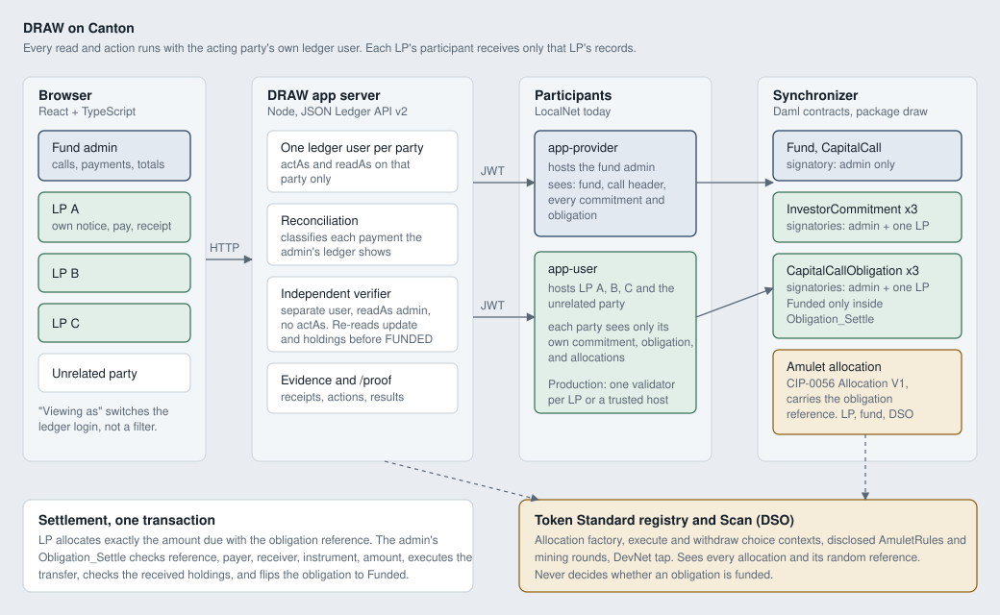

# DRAW

Private capital calls on Canton. Each investor reads and pays only its own notice, and the fund counts the money as deployable only after the settlement is read back from the ledger.

- Live demo on DevNet: https://draw.timjosh507.workers.dev
- Proof page: https://draw.timjosh507.workers.dev/proof
- Deck: link added at submission
- Demo video: link added at submission
- Every claim with its network and evidence: [`claims.yaml`](claims.yaml)

The live site runs on the HackCanton DevNet shared node, where one hackathon login signs for every seat. It settles in Canton Coin from the DevNet faucet, and the dollar figures are the scenario. A separate login per party, and a key held by each party, are shown on LocalNet.

## Try it in 3 minutes

Anyone can read the live site. Issuing, paying and settling need the demo access code, which the site prints on its landing page and fills in whenever it asks for it.

1. Open https://draw.timjosh507.workers.dev and click "Take a seat in the demo fund". If the page says there's no demo fund yet, click "Create the demo fund". Choose LP A, click Continue, then "Open the app", and click "Accept commitment" if LP A hasn't accepted yet. When the site asks for the access code, it's already filled in, so just continue.
2. Click "Switch seat" and choose Fund manager. Click "Create capital call". A fund's first call comes prefilled, with LP A paying 40 CC for $400,000. On a fund with earlier calls, give the call a new name and call LP A for an amount, for example $100,000 paid as 10 CC. Click "Issue capital call".
3. Switch seat to LP A. Open the notice for your call and click Pay. Copy the page address.
4. Switch seat to LP B and open LP A's notice address. The ledger query made as LP B returns nothing, so the page says "Not on your ledger".
5. Switch seat back to Fund manager, open the call and click Settle. Once the read-back step agrees, the obligation shows Funded and LP A's notice says "Verified funded".

If an LP's balance is short, "Add test CC" on its seat card taps the DevNet faucet.

Have a HackCanton login? On the seat screen, "Sign in with HackCanton" lets you join the demo fund as an LP yourself. Your browser reads your notices with your own login, you accept with it, and you pay from your own Canton wallet, either with the Pay button or with Accept under Allocations in the node's Canton Coin wallet. Switch to the Fund manager seat to issue your call and settle it.

## What is verified

Each row comes from [`claims.yaml`](claims.yaml), where DevNet and LocalNet claims are separate entries. Custody levels are explained under the table.

| Claim | Network | Custody | Evidence |
|---|---|---|---|
| The full call on the HackCanton node: two LPs settle with Canton Coin, bad payments are refused, the unpaid LP goes overdue, and the fund's totals match the coin it received. 79 of 79 checks on package 0.3.0 | DevNet | L0 | [DevNet run](evidence/devnet/runs/20261006T091531Z/result.json), [`totals.json`](evidence/devnet/runs/20261006T091531Z/totals.json), [first run, 72 of 72 on 0.2.0](evidence/devnet/runs/20261004T120110Z/result.json) |
| The deployed web app runs a call end to end: take a seat, issue, LP A pays, LP B gets nothing from LP A's link, settle, verified funded | DevNet, live site | L0 | [first run](evidence/devnet/browser/web-20261005003221/result.json), [redesigned UI](evidence/devnet/browser/web-journey-20261005214111/result.json), [a demo fund per browser](evidence/devnet/browser/web-journey-20261006091011/result.json), [with sign-in on](evidence/devnet/browser/web-journey-20261006101224/result.json) |
| An LP with its own HackCanton login joins as itself: it signs in on the node's Keycloak, its browser reads its notices with its own token, it accepts with that login, and it pays from its own Canton wallet, from DRAW or with Accept in the node's Canton Coin wallet. DRAW's server never receives its token | DevNet, live site | L1 for the LP's own login, used by the team's own account in these runs | [paid from DRAW](evidence/devnet/browser/web-hackcanton-20261006100912/result.json), [Accept in the Canton Coin wallet](evidence/devnet/browser/web-hackcanton-wallet-20261006101052/result.json) |
| Each LP's ledger view returns only its own commitment and obligations. Other LPs and an unrelated party get nothing, even with the contract id | DevNet: party-scoped reads and transaction streams. LocalNet: a separate login per party | L0 on DevNet, L1 on LocalNet | [`streams.json`](evidence/devnet/runs/20261006T091531Z/streams.json), [LocalNet `visibility-final.json`](evidence/local/runs/20261001T162427Z/visibility-final.json) |
| An obligation becomes funded only inside the transaction that executes a CIP-0056 allocation with its reference, payer, amount and asset | DevNet, LocalNet, Daml Script | L0, L1 | Receipts with 14 checks each: [DevNet](evidence/devnet/runs/20261006T091531Z/receipt-lpA.json), [LocalNet](evidence/local/runs/20261001T162427Z/receipt-lpA.json). [Daml tests](evidence/local/daml_core/20261006T081605Z/result.json), [15 of 15 broken guards caught](evidence/local/mutation/20261006T081625Z/result.json) |
| Each LP's call also reaches it as a CIP-0056 AllocationRequest, the Token Standard interface an app uses to ask a user for an allocation. Other LPs and outsiders can't see it. LP A paid by creating the allocation from that request, and the request closed when the call settled | DevNet, Daml Script | L0 | The `wallet` checks in the [DevNet run](evidence/devnet/runs/20261006T091531Z/result.json), `test_payment_request` in the [Daml tests](evidence/local/daml_core/20261006T081605Z/result.json) |
| A fund can name a verifier party that reads the fund, every call and every obligation. When it tries to act on them, the ledger refuses | Daml Script | n/a | `test_verifier` in the [Daml tests](evidence/local/daml_core/20261006T081605Z/result.json) |
| A wrong amount, wrong payer, wrong reference or replay is refused, and an unpaid LP goes overdue only after the due time | DevNet and LocalNet. Wrong executor, call and instrument in Daml Script only | L0, L1 | The `negative`, `deadline` and `unpaid` checks in each run's `result.json` |
| A separate read-back step confirms each settlement before it counts | DevNet: run with the same shared login. LocalNet: a separate read-only login that can't submit | L0 on DevNet, L1 on LocalNet | The receipts above. On DevNet `verifierUser` is the shared user |
| The read-back receipts are stamped 6.8 seconds (LP A) and 4.5 seconds (LP B) after the settlements' record times | DevNet | L0 | [`receipt-lpA.json`](evidence/devnet/runs/20261006T091531Z/receipt-lpA.json), [`receipt-lpB.json`](evidence/devnet/runs/20261006T091531Z/receipt-lpB.json), `recordTime` and `verifiedAt` |
| Payment locked to verified funded took 1,047 ms with a scripted admin | LocalNet, one machine | L1 | [workload](evidence/local/workload/20261002T185353Z/result.json), [`docs/WORKLOAD_ECONOMICS.md`](docs/WORKLOAD_ECONOMICS.md) |
| Each party can hold its own key. The node can't act for it without that signature, and another party's key is refused. 76 of 76 checks | LocalNet only | L2 | [custody run](evidence/local/runs/20261004T183146Z/result.json) |
| The same journey in a browser, including a run where each person signs every action with a key made in the browser. In the demo all keys sit in one browser | LocalNet, on the web app before the 2026-10-05 redesign | L1, and L2 with browser keys | [standard](evidence/local/browser/web-journey-20261005003621/result.json), [browser keys](evidence/local/browser/web-browser-keys-20261005005304/result.json) |
| Across 100 seeded calls (191 obligations): 0 false fundings, 0 privacy violations, 0 replays accepted, 0 total mismatches | LocalNet | L1 | [campaign](evidence/local/campaign/20261002T193724Z/result.json) |
| A database with a paid flag let 4 of 5 attacks through. DRAW let none through | LocalNet | n/a | [ablation](evidence/local/ablation/20261002T193830Z/result.json), [`docs/CANTON_ABLATION.md`](docs/CANTON_ABLATION.md) |

Custody levels:

- L0, shared login: one credential acts for several parties, and the node holds their keys. This is the DevNet demo seats.
- L1, own login per party: each party reads and acts with its own credential, and the node holds the keys. LocalNet standard runs, and on DevNet an LP that signs in with HackCanton.
- L2, own key per party: the party signs each transaction and the node can't act without that signature. The hosting node still validates and confirms. LocalNet custody run and browser-key journey.
- L3, the party's own node, or several independent confirming nodes. Roadmap.

Not claimed: MainNet, real money, or settlement in USDCx. Two different people's logins on DevNet: the sign-in runs used the team's own login, which the server also uses for the demo seats. Customers, pilots or partners. LP-held keys on DevNet. Payments hidden from the network, since Canton Coin transfers appear in Scan. A server that holds no credentials, since the demo server holds every demo seat's. A scheduler, partial payments, notifications or KYC.

## How to verify

1. Open the [proof page](https://draw.timjosh507.workers.dev/proof). It renders the DevNet run, the newest run of each browser journey on the live site with its screenshots, and the LocalNet suites, all from the result files, and links each one.
2. Read the files. Every `result.json`, receipt and log under `evidence/` was written by a script. Failed runs are kept, and [`docs/GATES.md`](docs/GATES.md#failed-and-aborted-runs) names each one and its cause. [`docs/PROOF.md`](docs/PROOF.md) explains each check, GATES lists the gate verdicts, and [`evidence/manifest.json`](evidence/manifest.json) indexes the runs with file hashes. The history was rewritten once, on 2026-10-05, before publication, so 12 of the 17 commit ids recorded in evidence before 2026-10-06, including those of the first DevNet run and the custody, 0.2.0 Daml core and clean-room runs, point at the old history. [`docs/PROOF.md`](docs/PROOF.md#commit-ids-in-the-evidence) maps each one to its published commit. Runs from 2026-10-06 record commits made after the rewrite.
3. Run them again:

```sh
node --test 'scripts/test/*.test.mjs'   # unit tests, no ledger needed
scripts/gates/daml_core.sh              # Daml Script suites (Daml SDK 3.5.12)
scripts/gates/mutation_check.sh         # 15 broken guards, each must be caught
node scripts/demo/run.mjs               # canonical call on LocalNet, or on DevNet with the DevNet block in .env
node scripts/eval/campaign.mjs          # 100 seeded calls on LocalNet
node scripts/eval/ablation.mjs          # database with a paid flag vs DRAW on LocalNet, same attacks
scripts/setup/clean_room.sh             # fresh clone, build, test, canonical run
(cd web && npm run e2e)                 # browser journey against LocalNet
```

DRAW was built with AI-assisted tools (Claude Code) for code, tests and documentation. The author directed the work and is responsible for all of it.

## The problem

A fund calls capital from its investors (LPs). Each LP gets a notice for its own share and pays by wire. Today's fund software attributes those wires to investors, but in batches from bank exports, with partial, split and wrong-name payments handled by hand. Funds count money as in only once it has cleared and been reconciled, and fake capital-call notices with swapped payment details are a known fraud pattern that funds fight with procedures, while the payment itself carries no check.

DRAW makes the obligation and the payment the same record. The payment carries the obligation's reference in a field the ledger checks, and the obligation becomes funded in the transaction that moves the money.

That's our working hypothesis about the workflow. Public evidence and its limits are in [`docs/PROBLEM_EVIDENCE.md`](docs/PROBLEM_EVIDENCE.md). No fund operator has been interviewed yet.

## What DRAW does

1. The fund manager issues a call. DRAW creates one obligation per LP, each a contract only that LP and the fund can see.
2. The LP opens its notice and pays in a Canton token. The payment is a Token Standard allocation that carries the obligation's reference.
3. The fund manager settles. In one transaction the ledger checks the reference, payer, amount and asset, moves the money, and marks the obligation funded. A wrong amount, the wrong payer, the wrong reference or a reused payment is refused.
4. A separate read-back step reads the settlement from the ledger. Only then does the dashboard count it as deployable.
5. Anyone who didn't pay stays unresolved. After the due time the fund manager can mark them overdue, send them to review, or waive them, each with a note.

The dashboard answers one question: how much of this call is deployable now, and how much is unresolved?

## Why Canton

On LocalNet we ran the same call on an ordinary database with a `paid` flag and role filtering in the app, then tried five attacks on both. Four got through the database. None got through DRAW ([`docs/CANTON_ABLATION.md`](docs/CANTON_ABLATION.md)).

- Privacy sits below the application. LP A's own ledger view never returns LP B's obligation, even by contract id, so a missing filter in the app can't leak it. Anyone holding the fund manager's credential can still read every LP, because the fund is a party to each obligation.
- Funded follows the money. The obligation flips in the same transaction that moves the token, and that transfer needs the LP's prior consent.
- Payments can't be reused. A settled allocation is consumed.

On the honest path both systems produce the same totals. The difference shows when something goes wrong.

## Architecture



The diagram shows the LocalNet setup, where each party has its own ledger user. On the DevNet node one hackathon login acts for every party, and the web app runs on Cloudflare in front of the API.

- Daml package `draw` ([`contracts/daml/daml/Draw/CapitalCall.daml`](contracts/daml/daml/Draw/CapitalCall.daml)): `Fund` and `CapitalCall` are admin-only. `InvestorCommitment` and `CapitalCallObligation` are signed by the admin and one LP. `FUNDED` is set in exactly one place, inside `Obligation_Settle`, after `Allocation_ExecuteTransfer`.
- Settlement: CIP-0056 Allocation V1 through the Splice token registry. Canton Coin on DevNet, through the validator's scan proxy, and Amulet on LocalNet.
- Web ([`web/`](web)): Next.js on Cloudflare Workers through OpenNext. Landing page, seat onboarding, the fund manager and LP apps, and the proof page. Every `/api/*` and `/evidence/*` request goes to the API with a service token, so the browser never talks to the VPS.
- API ([`app/server.mjs`](app/server.mjs)): Node, on a VPS behind Caddy, next to the ledger credentials. It reads and acts as each party, answers only the web app's proxy, and asks for the demo access code before any action. See [`docs/DEPLOY.md`](docs/DEPLOY.md).
- Ledgers: the HackCanton DevNet node run by NODERS (Canton 3.5.19, Splice 0.8.4) for the live site, and Splice LocalNet 0.8.4 for separate logins and browser keys.
- Visibility and authority matrix: [`docs/ARCHITECTURE.md`](docs/ARCHITECTURE.md).

## Roles

| Role | Sees | Does |
|---|---|---|
| Fund manager | Every commitment and obligation in its fund, every payment addressed to the fund | Issues calls, settles matching payments, marks overdue, reviews, waives, reopens |
| LP | Only its own commitment, obligations and payments | Accepts its commitment, pays, withdraws a refused payment |
| Unrelated party | Nothing | Nothing |

During onboarding you take a seat. Every screen after that is read from the ledger as that seat's party, and "Switch seat" signs out. On the shared DevNet node one hackathon login acts for every demo party. On LocalNet each party has its own login, or its own browser key in non-custodial mode.

## Run it locally

Requirements: Daml SDK 3.5.12 via `dpm`, JDK 21, Docker with about 10 GB of RAM and 6 GB of disk for LocalNet, Node 24, Chrome for the browser test.

```sh
export PATH="$HOME/.dpm/bin:$PATH" JAVA_HOME=/opt/homebrew/opt/openjdk@21

# Contracts
(cd contracts && dpm build --all)
scripts/gates/daml_core.sh
scripts/gates/mutation_check.sh

# LocalNet (Splice 0.8.4)
curl -sSfLO https://github.com/digital-asset/decentralized-canton-sync/releases/download/v0.8.4/0.8.4_splice-node.tar.gz
mkdir -p localnet && tar xzf 0.8.4_splice-node.tar.gz -C localnet && rm 0.8.4_splice-node.tar.gz
cd localnet/splice-node/docker-compose/localnet
export LOCALNET_DIR=$PWD IMAGE_TAG=0.8.4
docker compose --env-file compose.env --env-file env/common.env -f compose.yaml -f resource-constraints.yaml \
  --profile sv --profile app-provider --profile app-user up -d
cd -

# The app
DRAW_ENV_FILE=none node app/server.mjs                                  # API on :4173 against LocalNet
(cd web && npm ci && DRAW_API_URL=http://localhost:4173 npm run dev)   # http://localhost:3100
```

LocalNet uses its documented `unsafe` HS256 secret. Each party gets its own ledger user with rights on that party only. Start the API with `DRAW_PARTY_MODE=external` for browser keys, where each person creates a key in the browser and signs every action.

## Tests and proof campaign

```sh
node --test 'scripts/test/*.test.mjs'              # unit tests: payment classifier, outcome truth, login, config, signing relay
node scripts/demo/run.mjs                          # canonical call, writes evidence/local/runs/<run>
node scripts/demo/summary.mjs                      # plain-language summary of the latest run
node scripts/eval/campaign.mjs                     # 100 seeded cases (DRAW_EVAL_SEED, DRAW_EVAL_CASES)
node scripts/eval/ablation.mjs                     # database with a paid flag vs DRAW on LocalNet, same attacks
(cd web && npm run e2e)                            # browser journey against the real app and ledger
(cd web && DRAW_PARTY_MODE=external npm run e2e)   # non-custodial journey, every action signed in the browser
scripts/setup/clean_room.sh                        # fresh clone, build, test, and run
node scripts/evidence/manifest.mjs                 # index every evidence run with hashes
```

## DevNet

Copy `.env.example` to `.env` and uncomment the HackCanton block: your HackCanton login and the five party ids from the node's Console, after uploading `contracts/dist/draw-0.3.0.dar` there. Then run `node scripts/demo/run.mjs`. Evidence goes to `evidence/devnet/runs/`. `node scripts/demo/probe.mjs` records what the node allows your login without changing the ledger. The runbook and the record of each DevNet run are in [`docs/DEVNET_DEPLOYMENT.md`](docs/DEVNET_DEPLOYMENT.md).

## Known limitations

- On the DevNet node one hackathon login acts for every demo seat, including the read-back step. An LP can sign in with its own HackCanton login instead, but our runs of that used the team's own login. Separate logins and keys held by each party are shown on LocalNet.
- Every party on the DevNet node, and every LP on LocalNet, sits on one participant, so its operator can read them all.
- The demo server holds the credential of every demo seat. It never receives the token of an LP that signs in with HackCanton.
- Per the Splice Scan API docs, the Canton Coin leg of each payment involves the DSO and appears in Scan, with its random reference and the party ids, whose hints such as `draw-lpa` are readable. The obligations themselves don't appear there. We inferred this from the docs and haven't checked it against Scan.
- Settlement uses Canton Coin on DevNet and Amulet on LocalNet. The USDCx registry lists the same allocation API, but DRAW hasn't run with USDCx.

Full list: [`docs/LIMITATIONS.md`](docs/LIMITATIONS.md).

## Roadmap

- On DevNet, a read-only login for the read-back step and LPs that sign with their own keys. Both need the node operator, since tenant logins on the shared node can't create users or, by default, external parties ([`docs/DEVNET_DEPLOYMENT.md`](docs/DEVNET_DEPLOYMENT.md)).
- Production sign-in where the app server holds no LP credentials ([`docs/SECURITY.md`](docs/SECURITY.md)).
- Automatic settlement of exact matches is written (`DRAW_AUTO_SETTLE=true`) and hasn't run against a ledger yet.
- USDCx on TestNet and then MainNet, which needs Tokenomics Committee approval, plus a scheduler for overdue.

## Demo and pitch

[`docs/DEMO_SCRIPT.md`](docs/DEMO_SCRIPT.md) walks through the live DevNet site plus a labelled LocalNet segment. The business brief is [`docs/BUSINESS_BRIEF.md`](docs/BUSINESS_BRIEF.md), the pilot plan is [`docs/PILOT_PLAN.md`](docs/PILOT_PLAN.md), and the submission draft is [`docs/SUBMISSION.md`](docs/SUBMISSION.md).

Built from scratch during HackCanton Season 3. The first commit is dated 2026-10-01 ([`docs/HACKATHON_DELTA.md`](docs/HACKATHON_DELTA.md)).
