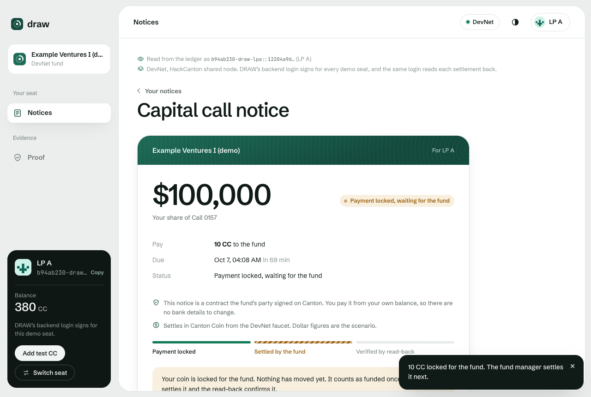
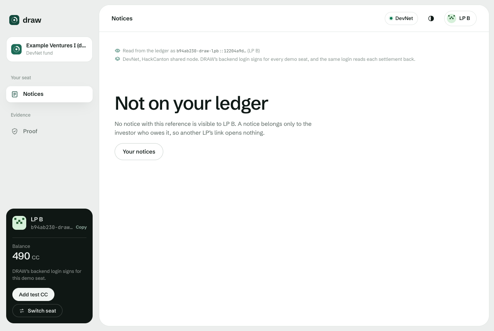
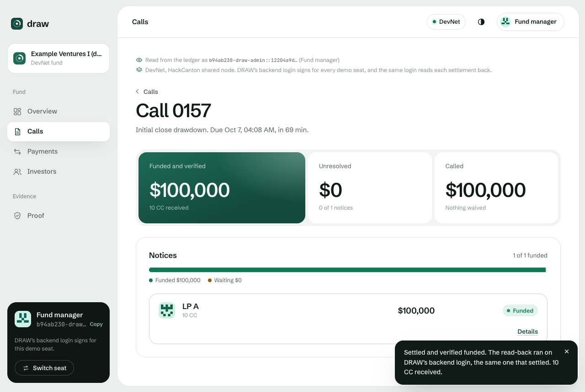

# DRAW

Private capital calls on Canton, for fund operations teams and the fund administrators who run calls for them.

- The problem. A capital call is how a fund collects money its investors, the LPs, already promised: the fund sends each LP a notice for its share, and the LP pays by a due date. Going by public process descriptions, the notice goes out by email today, each LP wires money with a hand-typed reference, and the operations team matches the wires to LPs before it can say how much of the call it can invest. Fake capital call notices are a known fraud.
- What DRAW does. Each LP's notice is a contract between the fund and that LP. The LP pays it from its own Canton wallet with the notice's reference inside the payment, and the notice turns funded in the same transaction that moves the money. The fund counts that money as deployable, meaning ready to invest, only after a read-back step reads the settlement from the ledger and checks it. Unpaid LPs stay on an explicit unresolved list.
- Why Canton. The ledger shows each notice only to the fund and that LP, so no other LP or unrelated party can read it, though the operator of the node that hosts them still can. The payment and the notice settle in one transaction. On LocalNet we ran the same call on an ordinary database with a `paid` flag, and write access marked an unpaid LP funded with one `UPDATE`. On a public chain, other LPs would see every LP's calls. [Why Canton](#why-canton) has the comparison.
- Try it. The live demo runs on Canton DevNet at https://draw.timjosh507.workers.dev. Take a seat as the fund manager or one of three LPs, or sign in with a HackCanton login and pay from your own Canton wallet. Actions need the demo access code, as [Try it in a few minutes](#try-it-in-a-few-minutes) explains. The proof page, https://draw.timjosh507.workers.dev/proof, shows the runs behind every claim and needs no code.
- What works today. On DevNet the whole call runs: issue, private notices, payment, settlement, read-back and overdue, 82 of 82 checks in the newest scripted run with one credential check skipped and its reason recorded. On the live site an LP signed in with its own HackCanton login pays from its own Canton wallet. DRAW's server signs for the demo roles, the live site's read-back uses that same login, and every sign-in run used the team's own login as the LP. There's no real money, customer, pilot or interview yet. [What runs where today](#what-runs-where-today) and [Limits](#limits) have the rest.

It settles in Canton Coin (CC), free test coin from DevNet's faucet with no monetary value. Each notice carries two separate amounts, a dollar figure for the business story and the coin amount that actually moves. The demo's call form fills in 1 CC for every $10,000, so a $400,000 notice is paid as 40 CC. That's a demo convention, and DRAW doesn't convert between the two.

[docs/README.md](docs/README.md) has the reading order and a [glossary of fund and Canton words](docs/README.md#words-used-in-these-docs), and [claims.yaml](claims.yaml) lists every claim with its network and evidence.

## A capital call in 30 seconds

Each LP commits an amount up front, and the fund draws it in parts when it needs it, which is why a capital call is also called a drawdown.

Here's one call as DRAW ran it on DevNet. A fund called $1,000,000 from three LPs. LP A ($400,000) and LP B ($350,000) paid 40 and 35 Canton Coin, and both payments were verified. LP C ($250,000) didn't pay, and the ledger let the fund mark it overdue only after the due time. The fund's totals came to $750,000 deployable now and $250,000 unresolved, and the fund received exactly 75 CC. Each LP's view of the ledger held only its own records, and payments with the wrong amount, payer or reference, and a replayed one, were refused instead of counted.

From [the scripted DevNet run](evidence/devnet/runs/20261006T131900Z/totals.json), 82 of 82 checks. Dollar figures are the scenario.

## Who it's for

- Fund operations. We built DRAW for the COO or operations lead at an emerging manager, meaning a newer, smaller fund manager. That person issues the call, matches wires to LPs, chases late payers and reports funded versus outstanding. The dashboard opens on the question we believe is theirs: "How much of this capital call is deployable right now, and what amount remains unresolved?"
- The outsourced fund administrator, who runs calls for several emerging managers. One relationship reaches several funds, so one administrator is our planned first channel.
- The LP, the counterparty. It gets a private notice and a clear answer: verified funded with a 14-check receipt, or refused with a reason.

Why an LP would move from wires to a Canton wallet is untested. DRAW offers it a notice signed by the fund's own party, which helps only if the LP knows that party, no emailed wire details to swap, a payment the ledger checks against the exact amount before it settles, and a receipt. It costs the LP a Canton party and holdings in a tokenized dollar. The first interviews ask whether LPs would do that ([icp.md](docs/pitch/materials/icp.md#what-the-interviews-will-test)).

Who pays is a hypothesis too. The manager might pay a subscription per fund, for a deployable figure tied to verified settlement and an explicit unresolved list, and the administrator might pay per call, for less matching work across its clients. When an administrator runs the call, the user and the payer differ. No pricing conversation has happened and no price is set. All of this rests on public sources, with 0 conversations held so far. More in [docs/pitch/materials/icp.md](docs/pitch/materials/icp.md) and [docs/BUSINESS_BRIEF.md](docs/BUSINESS_BRIEF.md).

DRAW runs one workflow, a capital call from issue to verified settlement. It isn't fund accounting, NAV, KYC, investor reporting, a secondary market, a lending product, an audit console or a generic dashboard. It isn't a fit yet for a fund whose LPs can't hold tokenized cash or a Canton party, the identity that signs and sees contracts on Canton. [LPs who pay by wire](#lps-who-pay-by-wire) explains why.

## The problem

Fund software already issues notices and matches bank payments. The gaps DRAW goes after are matching in batches from bank exports, hand work on partial, split and wrong-name payments, and payment instructions that can be forged by email.

Going by public process descriptions, a call today runs through a notice built in a spreadsheet or admin system, email, a wire from each LP, manual matching, a spreadsheet update, email follow-up and a report of funded versus outstanding. Our hypothesis is that until a payment is reconciled, fund operations can't safely treat the money as deployable, and that the workflow splits what each LP owes, the payment, the matching and what LPs are told across separate systems.

What the sources show, numbered as in [docs/PROBLEM_EVIDENCE.md](docs/PROBLEM_EVIDENCE.md):

- Notices are how LPs track their cash. "For LPs, capital call and distribution notices are essential tools for monitoring cash flow activity," said Neal Prunier of ILPA, the LP industry body, which released v2.0 of its notice template on 2025-09-11 [[1]](docs/PROBLEM_EVIDENCE.md).
- At least one fund administration vendor matches payments in batches from bank exports the client provides. Its service terms say "Client must provide a .csv file of recent bank transactions" for contribution reconciliation, and that contributions are updated "up to three times per capital call" [[10]](docs/PROBLEM_EVIDENCE.md).
- Partial and split payments are reconciled by hand [[11]](docs/PROBLEM_EVIDENCE.md), and "Cleared funds from the wrong name create AML and ownership headaches", per a vendor guide that is partly marketing [[9]](docs/PROBLEM_EVIDENCE.md).
- One vendor guide, partly marketing, advises counting money only once it has cleared: "Admit only when the sheet says cleared" [[9]](docs/PROBLEM_EVIDENCE.md).
- Fake notices are a known fraud. Luxembourg's Financial Intelligence Unit reports that "A wide range of scams using fake capital call or drawdown notices, falsified invoices or fraudulent loan repayment instructions has been detected" [[8]](docs/PROBLEM_EVIDENCE.md). The defense is procedure, such as "Require two people to approve any change to standing payment instructions" [[7]](docs/PROBLEM_EVIDENCE.md).
- Default remedies such as penalty interest "on the unfunded amount" need the exact amount funded, and when [[3]](docs/PROBLEM_EVIDENCE.md).

### What cuts against it

- Fiat tools already issue notices, attribute payments and track status [[10, 11, 12]](docs/PROBLEM_EVIDENCE.md), so on bank rails matching is a solved category, even where it runs in batches.
- LP defaults are rare [[4, 5]](docs/PROBLEM_EVIDENCE.md), so DRAW leads with telling late from funded and leaves chasing defaulters out.
- Nothing we found says a fund can't deploy before reconciliation finishes, and subscription credit lines may soften the urgency, though no source on file covers that.

12 public sources. 2 argue against, and 3 show fiat tools already handle notices and matching. None gave reconciliation hours, error rates or fraud losses, and we haven't spoken to a fund operator yet.

### Why now

- Canton's Token Standard, CIP-0056, gives a common way to lock a payment for one settlement with the reference inside it. DRAW settles through its allocation API.
- USDCx, which represents USDC deposited into Circle's xReserve, is a CIP-0056 token documented for TestNet and MainNet, and its MainNet registry metadata lists `splice-api-token-allocation-v1`, the allocation API DRAW settles through. DRAW hasn't run with USDCx.
- The industry is standardizing what a notice contains. ILPA released v2.0 of its capital call and distribution template in September 2025 [[1, 2]](docs/PROBLEM_EVIDENCE.md).

## How a capital call runs in DRAW

1. Set up, once per fund. The fund invites each LP with a committed amount, and the LP accepts once. Accepting lets the fund issue calls up to that commitment without asking the LP to sign each one, and DRAW's contract refuses a call above what's left, which is tested in Daml Script and hasn't run on a ledger yet. It also lets the fund's Settle action move a payment the LP has set aside, and DRAW's contract allows that only after every check passes and only on a payment the LP itself created. In the demo, commitments come from the demo setup.
2. Issue. The fund enters each LP's amount, and DRAW doesn't compute pro-rata shares. One action creates a separate notice per LP, a contract between the fund and that LP that no other LP or unrelated party can read. It carries the amount in scenario dollars and in token units, a due date and a random reference.
3. Payment request. The notice also reaches the LP as a CIP-0056 AllocationRequest, the Canton Token Standard's way for an app to ask a user to set funds aside for a settlement. That lets the LP's own Canton wallet list the call and pay it with Accept, shown so far only in the HackCanton node's Canton Coin wallet. Other LPs and unrelated parties can't see it.
4. Pay. The LP sets the exact amount aside in an allocation that carries the notice's reference. Nothing has moved yet, so it doesn't count. Only the exact amount settles. There are no partial payments, so any other amount is refused, and the LP withdraws it and pays again.
5. Settle. The fund clicks Settle. In one transaction the ledger checks the reference, payer, receiver, asset and exact amount, moves the coin to the fund and marks the notice funded. A mismatch or a replayed payment is refused with the ledger's reason, such as "allocation amount does not equal amount due".
6. Read back. A read-back step reads the settlement and the fund's holdings from the ledger and runs [14 checks](docs/PROOF.md#reading-a-receipt). Only a receipt that passes all 14 counts as verified funded, and only then does the dashboard count the money as deployable. Why a second step: the app's own record that it submitted a settlement isn't proof that money arrived. The read-back reads the settled transaction and the fund's coin holdings from the ledger, and a claim the ledger doesn't back, such as one notice's settlement offered as evidence for another, is marked CONTRADICTED and never counts. Each canonical run keeps one such refused receipt, and the LocalNet campaign contradicted 39 false claims. The read-back runs in the same process as the step that settles, so it checks the app against the ledger and isn't an outside audit.
7. Unpaid. The notice stays unresolved. The ledger refuses to mark it overdue before the due time, and after it the fund can, with a click. There's no scheduler.
8. Review and waive. The fund can send an open notice to review, for example after a payment from the wrong party, reopen it, put it back to awaiting payment when the payment it was waiting on was withdrawn or expired, or waive an overdue or reviewed notice, each with a note. A waived notice leaves the unresolved total, and the LP sees that it was waived.
9. Late payment. A late payment still settles, as 26 late payments did in the LocalNet campaign, and the settlement records that it came after the due time, which is checked in Daml Script.

The fund's overview opens on two numbers. Deployable now is money funded and confirmed by the read-back step, which here means received and verified in the fund's own holdings on the ledger. Moving it into a bank account isn't part of DRAW. Unresolved is everything called that isn't verified funded and isn't waived.

| LP A after paying | LP B opens LP A's link | The fund after Settle |
|---|---|---|
|  |  |  |
| Locked for the fund. Nothing has moved yet | The query made as LP B returns nothing | Settled, then verified by the read-back step |

These are from [the live-site browser run on 2026-10-07](evidence/devnet/browser/web-journey-20261007015754/result.json), a $100,000 call to LP A paid as 10 CC. On the live site a seat is one role in the demo, Fund manager, LP A, LP B or LP C, and one login NODERS issued for DRAW, the backend client, signs for every seat. [This screenshot](docs/pitch/img/devnet-signin-04-wallet-request-crop.png) shows the node's Canton Coin wallet listing a DRAW call with Accept, in a sign-in run with the team's own login as the LP. What each side sees at every step is in [docs/PRODUCT.md](docs/PRODUCT.md#a-capital-call-step-by-step).

## What changes for the fund and the LP

| Today | For fund operations | For the LP |
|---|---|---|
| A notice per LP, from a spreadsheet or admin system | Kept, as an on-ledger notice per LP | Its own notice, in DRAW |
| Sent by email | Removed. The LP reads its notice in DRAW, with no notifications yet | Reads the notice in DRAW, with no emailed wire details to swap |
| The LP wires money with a hand-typed reference | Replaced by an allocation carrying the reference in a field the ledger checks | Locks the exact amount from its own Canton wallet |
| Ops matches wires to LPs and amounts | For payments made through DRAW, replaced by the settle step's checks | Sees straight away if its payment doesn't match, withdraws it and pays again |
| Ops updates the spreadsheet | Removed. The notice turns funded in the settlement transaction | Sees "Verified funded" with a 14-check receipt |
| Ops chases unpaid LPs | Kept, and made explicit: overdue, in review or waived, each with a note | Sees if its notice is overdue, under review or waived |
| A report of funded versus outstanding | Recomputed from verified notices | |

The payment carries the notice's reference, and the notice turns funded in the same transaction that moves the money, so for payments made through DRAW the ledger check replaces off-ledger matching. Settling, marking overdue, and review and waive decisions stay manual. Our hypothesis is that the fund gets fewer reconciliation questions, less matching work and fewer surprises in reported funded capital. Nobody has measured that in a real fund.

### What the LP needs

- A Canton party, hosted by the LP itself or by a provider it trusts.
- Holdings in the settlement asset. Today that's Canton Coin from the DevNet faucet. On LocalNet, a Canton network that runs on one machine, it's Amulet, the token implementation behind Canton Coin. A real pilot needs an asset the fund and LPs already accept, such as a tokenized dollar.
- One acceptance of its commitment, on the ledger.
- A way to sign on a node that has vetted, meaning approved, DRAW's contract package, because every node that confirms a DRAW transaction must have. Two ways have run so far. On DevNet, the HackCanton node's own Canton Coin wallet, for an LP party on the same node as the fund, shown only with the team's own login. On LocalNet, a key the LP creates in its browser, with its party on LocalNet's LP participant, which hosts every LP there.

More in [docs/PRODUCT.md](docs/PRODUCT.md#what-the-lp-needs).

### LPs who pay by wire

Nothing in DRAW can mark a wire-paid notice funded, because settling is the only way to Funded. Such a notice stays unresolved or in review with a note, and never counts as deployable. A fund whose LPs all wire gets private notices and the unresolved list, without funding that follows the money. That's the real cold-start cost. Turning tokenized dollars into a bank wire the fund can invest isn't covered either. More in [docs/PRODUCT.md](docs/PRODUCT.md#lps-who-pay-by-wire).

### Fake notices

A DRAW notice is a contract signed by the fund's party, and only a payment to that party can fund it, so there are no emailed wire details on it to swap. That depends on the LP knowing the fund's real party, and DRAW doesn't build that onboarding. It can't stop fake instructions emailed outside DRAW, and no run has tested a fake-notice attack.

## Why Canton

Emailed notices are already private today. Privacy matters here because DRAW moves the notice and the payment onto a shared ledger, so the payment can settle the notice. On a ledger every participant can read, that would publish the LP book, as shown below. Canton keeps each notice from other LPs and unrelated parties, though the operator of the node that hosts them can still read it.

Why not the fund's own database? On LocalNet we ran the same $1,000,000 call on an ordinary operator database with a `paid` flag and role filtering in the app, and on DRAW, and tried the same five attacks on both. The database attacker had write access, as an operator or a compromised app server would.

| Attack | Database with a paid flag | DRAW |
|---|---|---|
| Mark an unpaid LP funded | Got through with one `UPDATE` | Stopped |
| Read another LP's notice | Got through. A query without the role filter returned two other investors | Stopped |
| Reuse one payment for another notice | Got through | Stopped |
| Count a payment row as money | Got through | Stopped |
| An LP changes its own notice | Stopped | Stopped |

4 of 5 got through the database and 0 of 5 got through DRAW, and on the honest path both gave $750,000 funded and $250,000 unresolved. Run on LocalNet with a separate ledger login per party, package 0.2.0: [the comparison run](evidence/local/ablation/20261002T193830Z/result.json).

Who gains from that? A fund that runs its own database is trusting its own staff and servers. LPs whose notices sit in that database, and the funds whose administrator runs it, trust that operator too. DRAW moves the funded and privacy checks onto the ledger, so write access can't fake them, though a node operator can still read every party it hosts.

A database shows the fund every notice, computes totals when nobody misbehaves and keeps LPs from writing just as well. What Canton changes is narrower:

1. Privacy sits below the app. A query run as LP A never returns LP B's notice, even by contract id, so a missing filter in a read path that runs as LP A can't leak it. Shown on LocalNet, where each party reads with its own ledger login. On DevNet, where one backend client reads for every seat, each party's reads and transaction stream held only its own records.
2. Funded follows the money. The notice turns funded only in the transaction that executes the token transfer, which needs the LP's prior consent, since the LP creates the allocation. Shown in Daml Script, DRAW's contract tests that run with no network, and on LocalNet and DevNet.
3. A payment can't be reused, because a settled allocation is consumed. Shown in Daml Script, on LocalNet and on DevNet.

DRAW pays through an allocation because it carries the reference in fields the Daml contract reads, `settlementRef.id` and `transferLegId`. A plain transfer would put it only in metadata Daml can't read back.

On a public chain with USDC, every participant, other LPs included, would see each LP's address, which ties together all of that LP's calls, with its amount due, commitment share, due date and paid or overdue state, plus the settlement holdings. That's the LP book. We read those fields off DRAW's own contract, and that comparison wasn't run.

Why would an LP pay a capital call in Canton Coin? It wouldn't. Canton Coin is the DevNet test asset, and a fund would call capital in a tokenized dollar such as USDCx, whose registry lists the allocation API DRAW settles through ([Why now](#why-now)). DRAW hasn't run with USDCx. Our hypothesis is that this could give funds and LPs a dollar rail they share.

What Canton doesn't hide or change:

- The fund sees every LP. On DevNet every party sits on one node, and on LocalNet every LP does, so that node's operator can read them all.
- Per the Splice token design, the DSO, the party that administers Canton Coin, is a stakeholder of each allocation and so sees its reference, which is random and names no one. No run has read the DSO's view. Per the Splice Scan API docs, the Canton Coin leg of each payment appears in Scan, the network's public explorer, with its random reference and the party ids, whose hints such as `draw-lpa` are readable, and the notices don't. We inferred this from the docs and haven't checked it against Scan.
- Subscription documents, fund terms, onboarding and KYC stay off the ledger. The commitment amount is on the ledger, but nothing there checks it against a signed subscription. Review, waive and chase stay human decisions, recorded with a note. Bank wires still reconcile elsewhere.

The full comparison is in [docs/CANTON_ABLATION.md](docs/CANTON_ABLATION.md). Ablation is the testing word for taking one part away, here Canton, to see what breaks.

## Try it in a few minutes

Every screen carries the network note "DevNet, HackCanton shared node. DRAW's backend login signs for every demo seat, and the same login reads each settlement back." It settles in Canton Coin from the DevNet faucet, and the dollar figures are the scenario. Every action, starting with "Create the demo fund", needs the demo access code. The site doesn't print the code, so without it a new browser can't start a demo fund and its seats stay empty. Reading needs no code: the proof page, and every seat of a demo fund this browser has already started.

1. Open https://draw.timjosh507.workers.dev and click "Take a seat in the demo fund". If this browser has no demo fund yet, click "Create the demo fund", enter the access code when asked, and wait while it funds each LP with test Canton Coin and sends the invitations.
2. Choose LP A, click Continue, enter the access code if the site asks for it, click "Open the app", then "Accept commitment". Use "Switch seat" to do the same as LP B and as LP C, since the call form lists only LPs that have accepted.
3. Switch seat to Fund manager and click "Create capital call". A new fund's first call comes prefilled with LP A at $400,000 as 40 CC, LP B at $350,000 as 35 CC and LP C at $250,000 as 25 CC, due 10 minutes ahead. Click "Issue capital call".
4. Switch seat to LP A, open the notice under "Your notices" and click "Pay 40 CC". The notice says the payment is locked for the fund. Copy the page address.
5. Switch seat to LP B and open LP A's address. The ledger query made as LP B returns nothing, so the page says "Not on your ledger". Then open LP B's own notice and pay it. To see a mismatch, first click "Pay a different amount" and pay 30. The notice says it doesn't match, and the app gives the fund no Settle button for it. When the scripted DevNet run tried to settle a wrong amount anyway, the ledger refused it with "allocation amount does not equal amount due". Click Withdraw, then "Pay 35 CC".
6. Switch seat to Fund manager, open Calls, then the call, and click "Settle 40 CC" and "Settle 35 CC". Once the read-back step agrees, the notices show Funded, LP A's notice says "Verified funded" with 14 of 14 checks, Deployable now counts both payments, and LP C's $250,000 stays unresolved.
7. Optional. Once the due time has passed, LP C shows under "Needs your attention". Click "Mark overdue".
8. Optional, with a HackCanton login whose party is onboarded in the node's Canton Coin wallet, which happens when you open that wallet once. On the seat screen, click "Sign in with HackCanton", then "Join as an LP", or "Start a demo fund and join as an LP" if this browser has no demo fund yet, then "Accept commitment". As Fund manager, issue the HackCanton LP a call. Back as that LP, pay from DRAW, or press Accept on the request under Allocations in the node's Canton Coin wallet. As Fund manager, settle, and the notice shows "Verified funded". Every run of this used the team's own login as the LP.

"Add test CC" on a seat card taps the DevNet faucet when a balance is short. Each browser gets its own demo fund. The funds share the same five parties, the fund, LP A, LP B, LP C and one unrelated party, so keeping one browser out of another's fund is the app's doing, and keeping each LP out of the others' records is the ledger's. By default the site starts at most 3 new demo funds per visitor an hour, and 20 an hour overall. If it can't start one, or you don't have the access code, the [proof page](https://draw.timjosh507.workers.dev/proof) shows the newest browser run of the core of this tour, step by step with screenshots, and needs no code.

## What runs where today

| Where | What runs there |
|---|---|
| Live site, DevNet | Take a seat, issue, LP A pays, LP B gets nothing from LP A's notice link, settle and verified funded passed in six browser runs on the HackCanton node (Canton 3.5.19, Splice 0.8.4). The two newest record package `draw` 0.3.0, and the first two ran before 0.3.0 existed. LP B's payment, the wrong amount and Mark overdue haven't run in a browser on DevNet. An LP signed in with its own HackCanton login pays from its own Canton wallet, with the team's own login in every run |
| Scripted run, DevNet | The full call, 82 of 82 checks plus one credential check skipped with its reason recorded, and the read-back on a client of its own. Earlier runs with one shared hackathon login passed 79 of 79 on 0.3.0 and 72 of 72 on 0.2.0 |
| LocalNet only | Splice LocalNet 0.8.4 with Amulet, on package 0.2.0 or earlier. A separate ledger login per party and a read-only read-back login. Each party holding its own key. The browser journey, with browser keys, and on the earlier app a refused wrong amount and an overdue LP. 100 seeded calls. The database comparison. 1,047 ms and 1,037 ms from payment locked to verified funded on one machine. A clean-room run on 2026-10-04, on the earlier web app |
| Daml Script only | Wrong executor, call and instrument refused. A call above an LP's remaining commitment refused. The paid-after-due record on a late payment. A verifier party a fund names. 15 of 15 deliberately broken copies of the contract's checks caught by the tests, which is mutation testing, on 0.3.0. 9 Daml Script tests, one of them the shared setup |
| Written but not run on a ledger | Automatic settlement of exact matches (`DRAW_AUTO_SETTLE=true`). Parties with their own keys allocated by the node operator (`DRAW_PARTY_MODE=external-provisioned`) |
| Not built | A scheduler for overdue, partial payments, notifications, onboarding and KYC, export to the administrator's system, fund manager sign-in, each LP on its own validator, USDCx, TestNet, MainNet, distributions, redemptions, NAV records |

## Roadmap

First customer, a hypothesis: one emerging manager, or one administrator running calls for a manager, with 2 to 5 LPs. Nobody has agreed to a pilot.

In this order, product first:

1. 3 to 5 twenty-minute conversations with fund COOs, ops leads, administrators or LPs about their last real call, with the demo held to the end, and 2 to 3 fifteen-minute usability tests on the live site. None has been held as of 2026-10-06, and results will go in only from notes, with quotes only with permission.
2. A shadow pilot of one real call with no money moving, then a small test settlement while the real call stays on the bank rail, as [docs/PILOT_PLAN.md](docs/PILOT_PLAN.md) sets out.
3. On DevNet, a read-back client that only reads, a sign-in run with a second person's login, and LPs that hold their own keys. These need NODERS or a second person.
4. Sign-in for every seat, the fund manager included.
5. Automatic settlement when a matching payment arrives.
6. TestNet with USDCx, then MainNet. TestNet needs approval from the Tokenomics Committee, an allowlisted IP address and an onboarding secret from a Super Validator, one of the operators that run the network and sponsor new validators.
7. Export to the administrator's system, a scheduler for overdue, and opaque party ids for new parties.

The ask: an introduction to someone who'd shadow one real call, and help getting onto TestNet. The channels we'll test and the pricing hypothesis are in [docs/pitch/materials/gtm.md](docs/pitch/materials/gtm.md).

## What is proven

Each row comes from one or more entries in [claims.yaml](claims.yaml), the ceiling for every public statement about DRAW, and [docs/PROOF.md](docs/PROOF.md#claim-by-claim) maps them one to one. DevNet and LocalNet stay separate, and Daml Script means DRAW's contract tests, with no network.

| Claim | Network | Who signed | Evidence |
|---|---|---|---|
| The full call. Two LPs settle in Canton Coin, each confirmed by a 14-check receipt. A wrong amount, payer and reference, a replay and an early overdue are refused, the unpaid LP goes overdue after the due time, and the totals match the coin received. 82 of 82 checks on package 0.3.0 | DevNet | One backend client for every demo seat, with the read-back on a client of its own | [20261006T131900Z](evidence/devnet/runs/20261006T131900Z/result.json), [totals](evidence/devnet/runs/20261006T131900Z/totals.json). Earlier, with one shared hackathon login for every party: [79 of 79](evidence/devnet/runs/20261006T091531Z/result.json), [72 of 72 on 0.2.0](evidence/devnet/runs/20261004T120110Z/result.json) |
| The deployed web app runs a call end to end: issue, LP A pays, LP B gets nothing from LP A's notice link, settle, verified funded | DevNet, live site | One backend client for every demo seat in the two newest runs, one shared hackathon login for every party before them | [web-journey-20261007015754](evidence/devnet/browser/web-journey-20261007015754/result.json). Earlier: [backend client](evidence/devnet/browser/web-journey-20261006132858/result.json), [first](evidence/devnet/browser/web-20261005003221/result.json), [redesign](evidence/devnet/browser/web-journey-20261005214111/result.json), [fund per browser](evidence/devnet/browser/web-journey-20261006091011/result.json), [sign-in on](evidence/devnet/browser/web-journey-20261006101224/result.json) |
| An LP signs in with its own HackCanton login on the node's Keycloak, reads its notices with its own token, accepts, and pays from its own Canton wallet, from DRAW or with Accept in the node's wallet. DRAW's server learns only its party id and never receives its token, and in the newest runs it held nothing that could act for that party | DevNet, live site | The LP's own HackCanton login (the team's own in every run) | [Paid from DRAW](evidence/devnet/browser/web-hackcanton-20261007015511/result.json), [Accept in the wallet](evidence/devnet/browser/web-hackcanton-wallet-20261007015632/result.json), [the backend client's rights](evidence/devnet/probes/20261006T133219Z/result.json), [first runs](evidence/devnet/browser/web-hackcanton-wallet-20261006101052/result.json) |
| Each LP's view holds only its own commitment and notices. Other LPs and an unrelated party get nothing, even by contract id | DevNet, through party-scoped reads and transaction streams. LocalNet | One backend client for every demo seat (DevNet). A separate ledger login per party (LocalNet) | [DevNet streams](evidence/devnet/runs/20261006T131900Z/streams.json), [LocalNet visibility](evidence/local/runs/20261001T162427Z/visibility-final.json) |
| A notice turns funded only in the transaction that executes a CIP-0056 allocation carrying its reference, from its LP, to the fund, for the exact amount and instrument. Each receipt records 14 checks, and on package 0.3.0 all 15 deliberately broken guards are caught | DevNet, LocalNet, Daml Script | One backend client for every demo seat (DevNet). A separate ledger login per party (LocalNet). Test runner (Daml Script) | Receipts on [DevNet](evidence/devnet/runs/20261006T131900Z/receipt-lpA.json) and [LocalNet](evidence/local/runs/20261001T162427Z/receipt-lpA.json), the [Daml tests](evidence/local/daml_core/20261006T081605Z/result.json), [15 of 15](evidence/local/mutation/20261006T081625Z/result.json) |
| Each LP's call also reaches it as a CIP-0056 AllocationRequest that other LPs and unrelated parties can't see. LP A paid from its request, which closed when the call settled. The run script made that allocation through the backend client, and LP B paid with a plain allocation carrying the reference | DevNet, Daml Script | One backend client for every demo seat. Test runner | The 7 `wallet` checks in [20261006T131900Z](evidence/devnet/runs/20261006T131900Z/result.json), `test_payment_request` in the [Daml tests](evidence/local/daml_core/20261006T081605Z/result.json) |
| A fund can name a verifier party that reads the fund, every call and every obligation, and the ledger refuses it when it tries to act | Daml Script | Test runner | `test_verifier` in the [Daml tests](evidence/local/daml_core/20261006T081605Z/result.json) |
| A wrong amount, payer or reference, or a replayed payment, is refused, and an unpaid LP goes overdue only after the due time | DevNet and LocalNet. Wrong executor, call and instrument in Daml Script only | One backend client for every demo seat (DevNet). A separate ledger login per party (LocalNet). Test runner (Daml Script) | The `negative`, `deadline` and `unpaid` checks in the [DevNet run](evidence/devnet/runs/20261006T131900Z/result.json) and the [LocalNet run](evidence/local/runs/20261001T162427Z/result.json), and the [Daml tests](evidence/local/daml_core/20261006T081605Z/result.json) |
| A read-back step confirms each settlement before it counts | DevNet, in the scripted run, on a client of its own that the ledger refused as the fund but that isn't read-only. The live site reads back through the backend client. LocalNet, on a read-only login | One backend client for every demo seat, with the read-back on its own client (DevNet). A separate ledger login per party (LocalNet) | The [DevNet receipts](evidence/devnet/runs/20261006T131900Z/receipt-lpA.json) and the [probe](evidence/devnet/probes/20261006T133219Z/result.json). A [LocalNet receipt](evidence/local/runs/20261001T162427Z/receipt-lpA.json) |
| The read-back receipts are stamped 6.4 s (LP A) and 5.1 s (LP B) after the settlements' record times, the verifier's clock against the ledger's | DevNet | One backend client for every demo seat, with the read-back on its own client | `recordTime` and `verifiedAt` in [receipt-lpA.json](evidence/devnet/runs/20261006T131900Z/receipt-lpA.json) and [receipt-lpB.json](evidence/devnet/runs/20261006T131900Z/receipt-lpB.json) |
| Payment locked to verified funded took 1,047 ms (LP A) and 1,037 ms (LP B), with the fund's side scripted to act at once. The three-LP call took 15 ledger transactions including setup, 1 to issue it | LocalNet, one machine | A separate ledger login per party | [Workload run](evidence/local/workload/20261002T185353Z/result.json), [docs/WORKLOAD_ECONOMICS.md](docs/WORKLOAD_ECONOMICS.md) |
| Each party can hold its own signing key, and the node can't act for it without that signature. Another party's key is refused. 76 of 76 checks | LocalNet only | Each party's own key | [Custody run](evidence/local/runs/20261004T183146Z/result.json) |
| The journey in a browser against the real app and ledger, including a run where each person signs every action with a key made in the browser, all in one browser for the demo. The 2026-10-04 runs on the earlier Vite app also refused a wrong amount and set an LP overdue | LocalNet, on the web app before the 2026-10-05 redesign | A separate ledger login per party, and each party's own key with browser keys | [Standard](evidence/local/browser/web-journey-20261005003621/result.json), [browser keys](evidence/local/browser/web-browser-keys-20261005005304/result.json), [earlier app](evidence/local/browser/20261004T184730Z/report.json), [earlier app with keys](evidence/local/browser/20261004T183631Z/report.json) |
| 100 seeded calls with 191 notices: 0 false fundings, 0 privacy violations, 0 replays accepted, and every total matched a reference model | LocalNet | A separate ledger login per party | [Campaign](evidence/local/campaign/20261002T193724Z/result.json) |
| A database with a paid flag let 4 of 5 attacks through, and DRAW let none through. The database attacker had write access, as an operator or a compromised app server would | LocalNet | A separate ledger login per party | [Comparison run](evidence/local/ablation/20261002T193830Z/result.json), [docs/CANTON_ABLATION.md](docs/CANTON_ABLATION.md) |

## Limits

- DevNet credentials. One backend client that NODERS issued for DRAW acts for all five DevNet demo parties, so LP-from-LP credential separation was tested on LocalNet only, and the DevNet check was skipped with its reason recorded. The read-back step's own DevNet client isn't read-only. It can act and read as the team's personal wallet party, which NODERS has been asked to remove, so the live server reads back through the backend client instead. On every network the read-back step runs in the same process as the submitter.
- Sign-in. Every sign-in run used the team's own login as the LP, so the same person held both sides, with different credentials in the newest runs. The LP's party must already be onboarded in the node's Canton Coin wallet, on the fund's node, and that wallet is the only one shown listing and approving a DRAW request. The token sits in the browser tab's session storage, and the site loads no third-party scripts.
- The demo server holds the backend client for every demo seat, and on LocalNet, whose signing secret is the public `unsafe`, it could sign a ledger login for any user. It never receives a signed-in LP's token and holds nothing that can act for that LP's party.
- One node hosts every party on DevNet and every LP on LocalNet, and its operator can read them all. Production needs each LP on its own validator, meaning its own Canton node, or with a provider it trusts. DevNet LPs don't hold their own keys, because such parties need NODERS to allocate them, and the team login's allocate call gets HTTP 403.
- Canton Coin and Amulet have no monetary value, and there's no real money, USDCx, MainNet or bank rail. DevNet resets about every three months, which would delete every party and contract.
- Each timing figure comes from one run, and campaign cases call at most three LPs. Expired allocations and mid-payment network failures weren't generated, and large calls haven't been tested against transaction size limits.
- One currency and instrument per fund. No partial payments, notifications, onboarding or KYC. Each demo fund has three demo LPs, one unrelated party and at most one signed-in LP.
- Package 0.3.0 has run only in Daml Script and on DevNet, and every LocalNet run used 0.2.0 or earlier. The redesigned onboarding and browser-key flow haven't run on LocalNet, and the current Next.js app hasn't had a clean-room run.

Not claimed: MainNet, real money or settlement in USDCx. Customers, pilots, partners or letters of intent. A second person's login on DevNet. LP-held keys on DevNet. Payments hidden from the network. A server that holds no credentials. An independent read-back on any network, or a read-only one on DevNet. That only the LP and the fund can read a notice, since the node operator can read every party it hosts. A scheduler, partial payments, notifications or KYC. That judges can hold their own key on DevNet. That any Canton wallet can pay a DRAW request.

The full list is in [docs/LIMITATIONS.md](docs/LIMITATIONS.md).

## How to verify

1. Open the [proof page](https://draw.timjosh507.workers.dev/proof). It renders the scripted DevNet run, the newest run of each live browser journey with its steps, screenshots and recorded setup, and the LocalNet suites, all from the result files.
2. Read the files. Every `result.json`, receipt and log under [evidence/](evidence) was written by a script. Failed runs are kept, and [docs/GATES.md](docs/GATES.md#failed-and-aborted-runs) names each one with its cause. [docs/PROOF.md](docs/PROOF.md) explains each check, and [evidence/manifest.json](evidence/manifest.json) indexes the runs with file hashes. The history was rewritten once, on 2026-10-05, before the repository was published, so 11 of the 16 commit ids in today's evidence files from before 2026-10-06 point at the old history, as did the `generatedAtCommit` of the 2026-10-05 manifest, now kept in git history. [docs/PROOF.md](docs/PROOF.md#commit-ids-in-the-evidence) maps each one to its published commit.
3. Run them again.

```sh
node --test 'scripts/test/*.test.mjs'              # unit tests, no ledger needed
scripts/gates/daml_core.sh                         # Daml Script tests (Daml SDK 3.5.12), no ledger needed
scripts/gates/mutation_check.sh                    # 15 deliberately broken guards, each must be caught
node scripts/demo/run.mjs                          # the scripted call on LocalNet, or on DevNet with the HackCanton block in .env
node scripts/demo/summary.mjs                      # plain-language summary of the latest run
node scripts/demo/probe.mjs                        # DevNet: what the node lets your login do, without changing the ledger
node scripts/eval/campaign.mjs                     # 100 seeded calls on LocalNet (DRAW_EVAL_SEED, DRAW_EVAL_CASES)
node scripts/eval/ablation.mjs                     # the database comparison on LocalNet, same five attacks
scripts/setup/clean_room.sh                        # fresh clone, build, tests and the scripted call
(cd web && npm run e2e)                            # browser journey against the real app and LocalNet
(cd web && DRAW_PARTY_MODE=external npm run e2e)   # the same journey, every action signed with a key made in the browser
node scripts/evidence/manifest.mjs                 # index every evidence run with file hashes
```

The unit tests, the Daml Script tests, the summary and the manifest need no ledger. The probe needs a HackCanton login, the scripted call runs on LocalNet or with one, and the rest need LocalNet, set up as in [Run it locally](#run-it-locally).

## How it works

- Daml package `draw` 0.3.0, in [CapitalCall.daml](contracts/daml/daml/Draw/CapitalCall.daml). The fund's party is called `admin` in the code. `Fund` and `CapitalCall` are signed by the fund. `InvestorCommitment` and `CapitalCallObligation`, the notice, are signed by the fund and one LP. A verifier party that the fund names observes the fund, every call and every notice, in Daml Script only so far. `PaymentRequest` is signed by the fund, observed by its LP, and implements the CIP-0056 `AllocationRequest` V1 interface. Funded is set in one place, inside `Obligation_Settle`, after `Allocation_ExecuteTransfer`.
- Settlement uses CIP-0056 Allocation V1 through the Splice token registry, with Canton Coin on DevNet and Amulet on LocalNet.
- The read-back step reads the settlement by its update id and the fund's holdings, runs the 14 checks and writes a receipt. The app shows Funded only for a notice with a `VERIFIED_FUNDED` receipt.
- Web, in [web/](web): Next.js on Cloudflare Workers through OpenNext. It forwards every `/api/*` and `/evidence/*` request to the API with a service token, so the browser never talks to the VPS.
- API, in [app/server.mjs](app/server.mjs): Node on a VPS behind Caddy, next to the ledger credentials, reached only with that service token. It asks for the demo access code before any action.
- Sign in with HackCanton: the LP's browser runs the authorization code flow with PKCE against the node's Keycloak, keeps the token in the tab and calls the node itself. DRAW's server learns only the LP's party id.
- Ledgers: the HackCanton DevNet node that NODERS runs, on Canton 3.5.19 and Splice 0.8.4, and Splice LocalNet 0.8.4.

More detail: [the live DevNet deployment](docs/ARCHITECTURE.md#the-live-devnet-deployment) and who sees what in [docs/ARCHITECTURE.md](docs/ARCHITECTURE.md), the trust model in [docs/SECURITY.md](docs/SECURITY.md), each Canton and Splice API DRAW calls with its source in [docs/SPONSOR_FINDINGS.md](docs/SPONSOR_FINDINGS.md), and the DevNet setup and run records in [docs/DEVNET_DEPLOYMENT.md](docs/DEVNET_DEPLOYMENT.md).

## Run it locally

Requirements: Daml SDK 3.5.12 via `dpm`, JDK 21, Docker with about 10 GB of RAM and 6 GB of disk for LocalNet, Node 24, Chrome for the browser test.

```sh
export PATH="$HOME/.dpm/bin:$PATH" JAVA_HOME=/opt/homebrew/opt/openjdk@21

# Contracts
(cd contracts && dpm build --all)
scripts/gates/daml_core.sh
scripts/gates/mutation_check.sh

# LocalNet (Splice 0.8.4)
curl -sSfLO https://github.com/digital-asset/decentralized-canton-sync/releases/download/v0.8.4/0.8.4_splice-node.tar.gz
mkdir -p localnet && tar xzf 0.8.4_splice-node.tar.gz -C localnet && rm 0.8.4_splice-node.tar.gz
cd localnet/splice-node/docker-compose/localnet
export LOCALNET_DIR=$PWD IMAGE_TAG=0.8.4
docker compose --env-file compose.env --env-file env/common.env -f compose.yaml -f resource-constraints.yaml \
  --profile sv --profile app-provider --profile app-user up -d
cd -

# The app
DRAW_ENV_FILE=none node app/server.mjs                                  # API on :4173 against LocalNet
(cd web && npm ci && DRAW_API_URL=http://localhost:4173 npm run dev)   # http://localhost:3100
```

LocalNet uses its documented `unsafe` HS256 secret. Each party gets its own ledger user with rights on that party only. Start the API with `DRAW_PARTY_MODE=external` for browser keys, where each person creates a key in the browser and signs every action.

For DevNet, copy `.env.example` to `.env`, uncomment the HackCanton block with your HackCanton login and the five party ids from the node's Console, and upload `contracts/dist/draw-0.3.0.dar` there first. With clients the node operator issued for DRAW, add the `DRAW_BACKEND_*` and `DRAW_VERIFIER_*` lines and run `LEDGER_AUTH_MODE=oauth node scripts/demo/run.mjs`, which is how the scripted DevNet run was made. The runbook and the record of every DevNet run are in [docs/DEVNET_DEPLOYMENT.md](docs/DEVNET_DEPLOYMENT.md).

## Read next

[docs/README.md](docs/README.md) has the full reading order, every other document and the glossary. To score by criterion, [docs/RUBRIC_ARTIFACT_MAP.md](docs/RUBRIC_ARTIFACT_MAP.md) maps each of the six judging criteria to where DRAW answers it. The main documents, in order:

1. [docs/PRODUCT.md](docs/PRODUCT.md): the call step by step for the fund and the LP.
2. [docs/BUSINESS_BRIEF.md](docs/BUSINESS_BRIEF.md): the business case on one page.
3. [docs/PROBLEM_EVIDENCE.md](docs/PROBLEM_EVIDENCE.md): the 12 public sources, for and against.
4. [docs/PILOT_PLAN.md](docs/PILOT_PLAN.md), then [docs/FIRST_UNIT_VALUE.md](docs/FIRST_UNIT_VALUE.md): the pilot and the cold-start cost.
5. [docs/CANTON_ABLATION.md](docs/CANTON_ABLATION.md): why Canton.
6. [docs/PROOF.md](docs/PROOF.md), then [claims.yaml](claims.yaml): the proof chain and every claim.
7. [docs/LIMITATIONS.md](docs/LIMITATIONS.md): what isn't done or shown.
8. [docs/ARCHITECTURE.md](docs/ARCHITECTURE.md), then [docs/SECURITY.md](docs/SECURITY.md): the model, the live deployment and the trust model.

## About this project

DRAW was built from scratch during HackCanton Season 3 by a single author. The first commit is dated 2026-10-01 ([docs/HACKATHON_DELTA.md](docs/HACKATHON_DELTA.md)). DRAW was built with AI-assisted tools (Claude Code) for code, tests and documentation. The author directed the work and is responsible for all of it. The product itself has no AI features. [CLAUDE.md](CLAUDE.md) holds the rules the AI coding assistant worked under, public as part of that disclosure.
