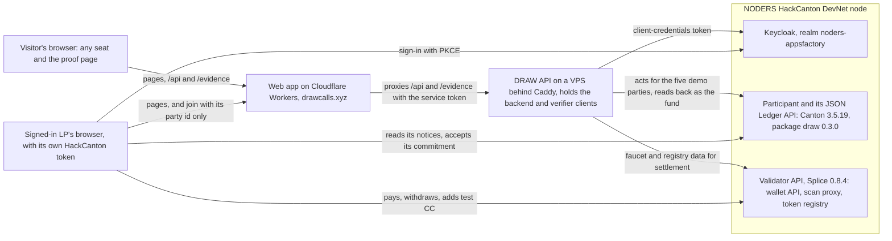

# Architecture

This is DRAW's technical reference, for readers who know Canton or want to check how the product works underneath. It covers the parties, the Daml templates, who can see which contract, how a payment settles a notice, how an LP signs in on DevNet, which credentials the live site holds, the notice states and how the totals are computed. For the workflow in fund terms, read [PRODUCT.md](PRODUCT.md) first. The trust model is in [SECURITY.md](SECURITY.md), and what isn't built or shown yet is in [LIMITATIONS.md](LIMITATIONS.md).

The fund's party issues a capital call, which creates one notice per LP, a contract between the fund and that LP that no other LP or unrelated party can read, though the operator of the node that hosts them can. Each notice also reaches its LP as a CIP-0056 AllocationRequest. The LP pays by locking the exact amount in a Token Standard allocation. The payment carries the notice's reference, and when the fund settles, Daml checks the allocation against the notice and the notice turns funded in the same transaction that moves the money. A read-back step then reads the settlement and the fund's holdings from the ledger and runs 14 checks. The app counts a notice as deployable only when its receipt passes all 14.

## The live DevNet deployment

The live site, https://drawcalls.xyz, runs on the HackCanton shared DevNet node that NODERS hosts for the hackathon: Canton 3.5.19, Splice 0.8.4, package `draw` 0.3.0. DRAW's backend login signs for every demo seat, and since about 13:00 UTC on 2026-10-07 a different login reads each settlement back. Payments settle in Canton Coin from the DevNet faucet, and the dollar figures are the scenario.



- The web app ([web/](../web/), Next.js on Cloudflare Workers through OpenNext) serves the landing page, the seats, the app and the proof page. It proxies every `/api` and `/evidence` request to the API with a service token, so a visitor's browser never talks to the VPS.
- The API ([app/server.mjs](../app/server.mjs)) runs on a VPS behind Caddy. Its ledger credentials are two clients NODERS issued for DRAW. The backend client acts for the five demo parties (the fund manager, LP A, LP B, LP C and an unrelated party), reads as the fund, and has no other rights. It submits every demo seat's actions. Since about 13:00 UTC on 2026-10-07 the read-back step reads through the verifier client, which can only read as the fund, and before that it read through the backend client ([Credentials on DevNet](#credentials-on-devnet)).
- The validator's scan proxy and token registry supply the allocation factory, choice contexts and disclosed contracts that a payment, a settlement and a faucet tap need. They never decide whether a notice is funded.
- A signed-in LP's browser calls the node's Keycloak, JSON Ledger API and validator API directly with its own token. DRAW's server learns only that LP's party id and never receives its token ([Sign in with HackCanton](#sign-in-with-hackcanton-devnet)).
- Every party sits on the one NODERS participant, so that operator can read every party it hosts. Production needs each LP on its own validator or with a provider it trusts.

How to deploy each part is in [DEPLOY.md](DEPLOY.md), and the record of the node and every DevNet run is in [DEVNET_DEPLOYMENT.md](DEVNET_DEPLOYMENT.md). [architecture.svg](architecture.svg) shows the LocalNet layout as drawn on 2026-10-02, before the Cloudflare and VPS split and before the current Next.js web app. Its box still carries the old label "Independent verifier". It's the LocalNet read-back step: a separate ledger user that reads as the fund and can't submit, run from the same process as the submitter, so DRAW doesn't call it independent. The diagram's top line, "Every read and action runs with the acting party's own ledger user", holds on LocalNet only. On DevNet one backend client acts for every demo seat, and in the run with external parties one login submitted what each party's key signed.

## Ordering note

The visibility matrix below was designed before the templates were written, and the named Daml tests now assert it. The tables were checked in after [CapitalCall.daml](../contracts/daml/daml/Draw/CapitalCall.daml) existed. Every Y/N cell for DRAW templates is asserted by `test_visibility`, `test_settlement_lifecycle` and, for payment requests, `test_payment_request`, all in [CapitalCallTest.daml](../contracts/tests/daml/Draw/Test/CapitalCallTest.daml). Cells marked UNVERIFIED haven't been run on a participant.

The tables describe package 0.3.0, a Smart Contract Upgrade of 0.2.0 that adds `PaymentRequest` and the optional verifier party. Package 0.3.0 has run in Daml Script and on DevNet. Every LocalNet run used 0.2.0 or earlier.

## Actors

An obligation (`CapitalCallObligation`) is what the app and the other documents call a notice. In the tables, `admin` is the fund's Daml party and `lp` is the LP a contract belongs to.

| Actor | Daml party | Notes |
|---|---|---|
| Fund | `admin` (`draw-admin` for the demo seats on the DevNet node, `b94ab230-ext-1` in the run with external parties) | the fund's party (the Fund manager seat in the app), executor and receiver of every settlement |
| LP A, LP B, LP C | `lpA`, `lpB`, `lpC` | one party each, each with its own credential on LocalNet. On the DevNet node one backend client acts for all the demo seats. In one DevNet run every party, the fund included, was an external party that signed with its own key ([Credentials on DevNet](#credentials-on-devnet)) |
| Signed-in LP (DevNet) | the wallet party of a HackCanton login | joins a demo fund as itself and acts only with its own login, from its browser ([Sign in with HackCanton](#sign-in-with-hackcanton-devnet)) |
| Unrelated | `outsider` | allocated on the same network, no relationship |
| Verifier (optional, 0.3.0) | `verifier` | named on a fund when it is created, and an observer of that fund, its calls and its obligations. Daml Script only so far |
| Registry admin | DSO on LocalNet and DevNet, `registrar` in tests | token infrastructure. Per the Splice token design it sees token contracts only, which no run has checked |

## Templates

All DRAW templates are in [CapitalCall.daml](../contracts/daml/daml/Draw/CapitalCall.daml).

| Template | Signatories | Observers | Created by | Choices (controller) | Archived on | Holds |
|---|---|---|---|---|---|---|
| `Fund` | admin | verifier, if named | admin | `Fund_InviteInvestor` (admin, nonconsuming), `Fund_IssueCall` (admin, nonconsuming) | never | fund id and name, the optional verifier. No LP roster |
| `CommitmentInvitation` | admin | lp | `Fund_InviteInvestor` | `Invitation_Accept` (lp), `Invitation_Decline` (lp), `Invitation_Withdraw` (admin) | any choice | one LP's commitment offer |
| `InvestorCommitment` | admin, lp | none | `Invitation_Accept` | `Commitment_IssueObligation` (admin) | each call, recreated with new called amount | one LP's committed and called amounts |
| `CapitalCall` | admin | verifier, if named | `Fund_IssueCall` | none | never | call id, due date, obligation refs, totals. No LP parties or per-LP amounts |
| `CapitalCallObligation` | admin, lp | verifier, if named | `Commitment_IssueObligation` | `Obligation_MarkPaymentPending`, `Obligation_Settle`, `Obligation_MarkOverdue`, `Obligation_FlagManualReview`, `Obligation_ReleasePending`, `Obligation_Reopen`, `Obligation_Waive` (all admin). `Obligation_Settle` and `Obligation_Waive` take an optional `paymentRequestCid` and archive that request | every state change, recreated | one LP's amount due, reference, state, settlement record, issue time |
| `PaymentRequest` (0.3.0), implements CIP-0056 `AllocationRequest` V1 | admin | lp | `Commitment_IssueObligation`, next to each obligation | `AllocationRequest_Reject` (the LP only, checked in the choice), `AllocationRequest_Withdraw` (the executor, which is the admin) | reject, withdraw, or the settle or waive of its obligation when its id is passed | the request the LP reads as an AllocationRequest: settlement (executor admin, reference the obligation ref, requested at issue, allocate before the due time, settle before the due time plus 7 days) and one transfer leg keyed by the obligation ref, LP to admin, for the amount and instrument due |
| Token `Allocation` (Amulet on LocalNet, Canton Coin on DevNet) | registry admin, sender (Amulet: UNVERIFIED) | executor, receiver | LP through `AllocationFactory_Allocate`, either from its payment request's settlement and leg or with the reference set directly | `Allocation_ExecuteTransfer` (executor + sender + receiver) | on execution | one LP's locked payment for one obligation reference |

## Visibility matrix

| Contract | Fund | LP A | LP B | LP C | Unrelated | Asserted by |
|---|---|---|---|---|---|---|
| Fund | Y | N | N | N | N | `test_visibility` |
| CapitalCall | Y | N | N | N | N | `test_visibility` |
| LP A commitment | Y | Y | N | N | N | `test_visibility` |
| LP B commitment | Y | N | Y | N | N | `test_visibility` |
| LP C commitment | Y | N | N | Y | N | `test_visibility` |
| LP A obligation | Y | Y | N | N | N | `test_visibility`, by query and by `queryContractId` with a known id |
| LP B obligation | Y | N | Y | N | N | same |
| LP C obligation | Y | N | N | Y | N | same |
| LP A obligation after settlement | Y | Y | N | N | N | `test_settlement_lifecycle` |
| LP A payment request | Y | Y | N | N | N | `test_payment_request`. On DevNet, the `wallet` checks of [the canonical DevNet run](../evidence/devnet/runs/20261007T130259Z/result.json) |
| LP B payment request | Y | N | Y | N | N | same |
| LP C payment request | Y | N | N | Y | N | same |
| LP A allocation | Y | Y | N | N | N | test token only. Amulet: UNVERIFIED |
| Fund's received holding | Y | N | N | N | N | test token only. Amulet: UNVERIFIED |

A named verifier party sees the fund, every call and every obligation, including the settlement record, and no commitment, invitation or payment request (`test_verifier`). A fund that names no verifier shows it nothing (`test_no_verifier`). It can't act on what it sees: flagging an obligation for review and inviting an investor both fail authorization.

On LocalNet, with a separate ledger login per party, each LP could read only its own commitment and obligation, even by contract id. On DevNet each party's view and transaction stream held only its own records, read through one credential that queries as the chosen party: the backend client, or in the run with external parties the team's own login. [PROOF.md](PROOF.md) says where each result is and how to rerun it.

## What each exercise discloses

| Transaction | Root | What each LP's projection contains | What the unrelated party learns |
|---|---|---|---|
| Issue call | `Fund_IssueCall` on `Fund`, which no LP can see | its own `Commitment_IssueObligation` exercise, its recreated commitment, its new obligation and its payment request. Not the root, not the `CapitalCall` create, not other LPs' subtrees | nothing |
| Mark pending | `Obligation_MarkPaymentPending` on one obligation | that LP: the exercise, the fetch of its own allocation, the new obligation. Other LPs: nothing | nothing |
| Settle | `Obligation_Settle` on one obligation | that LP: the exercise and everything under it, including the archive of its payment request when its id is given, `Allocation_ExecuteTransfer` and the creation of the fund's received holding (the LP is a witness of its own payment). Other LPs: nothing | nothing |
| Overdue, review, waive | choice on one obligation | that LP only | nothing |

The registry admin (the DSO on LocalNet and DevNet) is a stakeholder of the allocation and the holdings, so it witnesses the `Allocation_ExecuteTransfer` subtree. It isn't a stakeholder of the obligation and doesn't see the parent exercise, or the obligation reference outside the allocation's own fields. The allocation's `settlementRef.id` is visible to the DSO, so references must not encode LP names or amounts. That is why they're random ([DECISIONS.md, D-009](DECISIONS.md#d-009-opaque-obligation-references-2026-10-01)). All of this is UNVERIFIED on both networks, since no run has read the DSO's view.

Scan serves what the DSO observes, which per the Splice Scan API docs includes Canton Coin transfers and excludes most other things. So per those docs, the Canton Coin leg of each payment appears in Scan with its random reference and the party ids, whose hints such as `draw-lpa` are readable, and the notices don't. We inferred this from the docs and haven't checked it against Scan.

## Settlement lifecycle

```text
Issue: one obligation and one PaymentRequest per LP. The LP reads the request as a CIP-0056 AllocationRequest
LP: AllocationFactory_Allocate (settlementRef.id = transferLegId = obligation ref,
    executor = receiver = admin, amount = amountDue)          -> Allocation (ACTION_REQUESTED -> ACKNOWLEDGED)
Fund (admin): read the Allocation from the admin's ACS        -> Obligation_MarkPaymentPending   (PAYMENT_PENDING)
Fund (admin): Obligation_Settle                                 (one transaction)
  checks ref, leg id, executor, sender, receiver, instrument, exact amount
  exercises Allocation_ExecuteTransfer with admin + LP authority
  fetches every receiver holding: owner = admin, instrument matches, sum = amountDue
  recreates obligation as Funded with SettlementRecord     -> contract state Funded (TRANSFER_EXECUTED, CLAIMED_FUNDED)
Read-back step: read the update by id + the admin's holdings -> evidence VERIFIED_FUNDED
```

The words in capitals are DRAW's state and outcome labels. The app never counts a submitted transaction, a signature or a hash as funded, only a `VERIFIED_FUNDED` receipt ([Aggregation](#aggregation)).

Who runs the read-back depends on the network and the setup:

- LocalNet: a separate ledger login with read rights on the fund only, which each run checks can't submit.
- [The run with external parties](../evidence/devnet/runs/20261007T130259Z/), the canonical DevNet run: the team's own login, the same one that submitted for every party, because the verifier client may read only as the regular fund party and not as the external one.
- [Run 20261007T125638Z](../evidence/devnet/runs/20261007T125638Z/), and the live site since about 13:00 UTC on 2026-10-07: the verifier client NODERS issued, a different ledger user from the seats. [Probe 20261007T125624Z](../evidence/devnet/probes/20261007T125624Z/result.json) records it reading only as the fund, and the ledger refused it when the run tried to act as the fund with it.
- [Run 20261006T131900Z](../evidence/devnet/runs/20261006T131900Z/): the verifier client, while it could also act and read as the team's personal wallet party, a right NODERS removed on 2026-10-07.
- The live site before about 13:00 UTC on 2026-10-07: the backend client, the same credential as the seats.
- The earlier DevNet runs: one shared hackathon login for every step.

In every case the read-back runs in the same process as the submitter, in the scripts and in the app. When a fund names a verifier party, the read-back reads through that party instead of the fund's. The verifier party's view is tested in Daml Script only, and no ledger run has read back through it yet.

The receipt's 14 checks are listed in [PROOF.md](PROOF.md#reading-a-receipt). The read-back also refuses an update id it already used for a different obligation, and any update that doesn't itself settle the claimed obligation.

The payment request's settlement and leg are exactly what `Obligation_Settle` checks, so an allocation created from the request passes unchanged (`test_payment_request`). On DevNet, LP A paid that way in the passing scripted runs on 0.3.0, using the same factory call a wallet makes. In [the run with external parties](../evidence/devnet/runs/20261007T130259Z/) LP A's own key signed its allocation. In the others the run script created it through the demo seats' shared credential, [the backend client](../evidence/devnet/runs/20261007T125638Z/) and before it [the shared hackathon login](../evidence/devnet/runs/20261006T091531Z/). LP B paid with a plain allocation carrying the reference, which settles the same way. A signed-in LP paid from its own Canton wallet in the sign-in runs, either from DRAW or with Accept in the node's Canton Coin wallet (next section).

Why the obligation is co-signed: `Allocation_ExecuteTransfer` needs the executor, the sender and the receiver. The fund's party is executor and receiver. The LP's authority comes from its signature on the obligation, which it gave once, by accepting its commitment, so it doesn't sign each call. Inside `Obligation_Settle` the fund can use that authority only on an allocation the LP itself created and that passes every check. The mutation check shows that if the sender or executor check is removed, Daml authorization still blocks the transfer ([DECISIONS.md, D-005](DECISIONS.md#d-005-obligations-are-co-signed-by-admin-and-lp-2026-10-01)). A call above the LP's remaining commitment is refused with "call exceeds remaining commitment".

Why an allocation and not a plain transfer: the allocation carries the reference in `settlementRef.id` and `transferLegId`, fields Daml can read. A plain `TransferFactory_Transfer` would put it only in choice-argument metadata, which Daml can't read back ([DECISIONS.md, D-004](DECISIONS.md#d-004-settle-through-cip-0056-allocation-not-a-plain-transfer-2026-10-01)).

Replay: `Allocation_ExecuteTransfer` is consuming, so the same allocation can't settle twice. A funded obligation also refuses `Obligation_Settle`. Both are tested.

## Sign in with HackCanton (DevNet)

An LP with its own HackCanton login can join a demo fund as itself. The API turns this on with `DRAW_SIGN_IN=true`, and only when each browser has its own demo fund. Every run of it signed in with the team's own login as the LP. The two newest, [paying from DRAW](../evidence/devnet/browser/web-hackcanton-20261007130106/) and [paying with Accept in the node's wallet](../evidence/devnet/browser/web-hackcanton-wallet-20261007130229/), ran with the demo seats on the backend client, the read-back on the verifier client and the browser on DRAW's own web client, as their `siteSetup` records. The first four used NODERS' public web-app client `web-app-ui-hackcanton-01-devnet`.

```text
LP's browser -> node's Keycloak (realm noders-appsfactory, DRAW's public client xidoncapitals-web-app-hackcanton-01-devnet)
                authorization code with PKCE, back to https://drawcalls.xyz/auth/callback
                token kept in this tab's sessionStorage, renewed with the refresh token
LP's browser -> JSON Ledger API GET /v2/authenticated-user     -> primaryParty, the login's wallet party
LP's browser -> DRAW API action "join" { party }               (the party id is all DRAW receives)
DRAW API     -> Fund_InviteInvestor as the fund manager        -> invitation to commit $200,000
LP's browser -> JSON Ledger API, with its own token:
                POST /v2/state/active-contracts-page           CommitmentInvitation, InvestorCommitment,
                                                               CapitalCallObligation, Allocation and
                                                               AllocationRequest interfaces
                POST /v2/commands/submit-and-wait-for-transaction  Invitation_Accept
Fund manager seat (backend client) issues the call           -> obligation + PaymentRequest for the LP
LP pays from its own Canton wallet, with its own token:
                DRAW's Pay button -> POST {validator}/api/validator/v0/allocations
                or Accept on the request under Allocations in the node's Canton Coin wallet
Fund manager seat settles -> read-back step -> receipt          (as for every LP)
LP's browser -> DRAW API GET /api/record?ref=                  -> DRAW's own receipt and logged steps
```

Who reads what:

| Reader | Credential | Reads |
|---|---|---|
| The signed-in LP's browser | its own HackCanton token | its invitation, commitment, notices, payment requests and allocations, from the JSON Ledger API. Its balance from `GET /api/validator/v0/wallet/balance`. It classifies its own payments with [reconcile.mjs](../scripts/demo/lib/reconcile.mjs), the module the server uses |
| DRAW's API | the backend client as the fund manager party, and the verifier client for the read-back | the fund's own records, which include the LP's commitment, notices and the payments addressed to the fund, since the fund is a party to each. It keeps DRAW's own record per notice, the read-back receipt and logged steps, and serves only that to the LP at `GET /api/record?ref=` |
| The node's Canton Coin wallet | the LP's own login | each DRAW notice as a V1 allocation request, with Accept, Reject and, after Accept, Withdraw |

The LP pays, withdraws its own payment (`POST /api/validator/v0/allocations/{cid}/withdraw`) and taps test CC (`POST /api/validator/v0/wallet/tap`) through its wallet's API. A late LP can still pay from DRAW. The wallet call gets a fresh one-hour allocate window, which works because `Obligation_Settle` checks reference, leg id, executor, payer, receiver, instrument and amount, and no times. When a demo fund closes, on start over or when the API forgets the tour, the fund manager withdraws its open payment requests with `AllocationRequest_Withdraw` as the executor, so no LP's wallet keeps offering a closed fund's notice. An LP withdraws its own locked coin in its wallet.

The LP's party is its login's wallet party on the same NODERS participant as the fund, which has DRAW's package vetted. Every participant that confirms a DRAW transaction must have vetted DRAW's package, so on DevNet today the LP's wallet is the node's own Canton Coin wallet, the only wallet shown listing and approving a DRAW request. A login with no wallet party yet has to onboard in the node's wallet first.

## Credentials on DevNet

NODERS issued DRAW three Keycloak clients on 2026-10-06. The backend and verifier clients get client-credentials tokens, which carry the node's audience, scope `daml_ledger_api` and a 3-hour expiry.

| Client | Kind | Used for | Rights the node reports |
|---|---|---|---|
| `xidoncapitals-web-app-hackcanton-01-devnet` | public, PKCE, with the live site's origin and `localhost:3100` as web origins | an LP's own sign-in in its browser | the signed-in user's own |
| `xidoncapitals-backend-hackcanton-01-devnet` | client credentials, with a secret | every demo seat, on the live server since about 13:25 UTC on 2026-10-06 and in runs [20261006T131900Z](../evidence/devnet/runs/20261006T131900Z/) and [20261007T125638Z](../evidence/devnet/runs/20261007T125638Z/) | acts for the five demo parties and reads as `draw-admin`, nothing else ([probe 20261007T125624Z](../evidence/devnet/probes/20261007T125624Z/result.json)) |
| `xidoncapitals-verifier-hackcanton-01-devnet` | client credentials, with a secret | the read-back step in runs [20261006T131900Z](../evidence/devnet/runs/20261006T131900Z/) and [20261007T125638Z](../evidence/devnet/runs/20261007T125638Z/), and on the live server since about 13:00 UTC on 2026-10-07 | reads as `draw-admin`, nothing else ([probe 20261007T125624Z](../evidence/devnet/probes/20261007T125624Z/result.json)). It could also act and read as the team's personal wallet party until NODERS removed that right on 2026-10-07 ([probe 20261006T133219Z](../evidence/devnet/probes/20261006T133219Z/result.json)) |

The canonical DevNet run, [20261007T130259Z](../evidence/devnet/runs/20261007T130259Z/), used none of these clients. Its five parties, `b94ab230-ext-1` to `-ext-5` (the fund, LP A, LP B, LP C and the unrelated party), are external parties that NODERS allocated on 2026-10-07 from onboarding transactions DRAW generated and signed, since a team's own allocate call is refused on this node. The node prepares each transaction and the acting party's own Ed25519 key signs it. One login, the team's own, submitted for every party and read each settlement back. The ledger refused it when it tried to act for LP A without LP A's key, and refused LP B's key signing for LP A. All five keys sat on the machine that ran the script, so the run shows that the ledger needs each party's signature. It doesn't show that separate people held the keys. The live site doesn't use these parties.

How a run and the site decide what they can claim:

- Settings: `DRAW_BACKEND_CLIENT_ID` and `DRAW_BACKEND_CLIENT_SECRET` for the seats, `DRAW_VERIFIER_CLIENT_ID` and `DRAW_VERIFIER_CLIENT_SECRET` for the read-back. User ids are optional, since each is read from its token's subject. A `DRAW_*_USER` that is set and disagrees with its token stops a run, a probe and the server's credential report.
- With a shared login, every role resolves to that login's own ledger user, whatever user ids are set.
- `seatCredential` says who acts for the demo seats: `shared-login`, `backend-client`, `shared-user` or `per-seat`. `credentialSeparation` is `TESTED`, `VERIFIER_ONLY`, `SEATS_ONLY` or `NOT_TESTED_SINGLE_CREDENTIAL`, decided from the ledger users the tokens resolve to. Run 20261007T125638Z records `backend-client` and `VERIFIER_ONLY`. The run with external parties records `shared-login` and `NOT_TESTED_SINGLE_CREDENTIAL`, and its `custody` is `EACH_PARTY_SIGNS_WITH_ITS_OWN_KEY` where the other DevNet runs on 0.3.0 record `SERVER_SUBMITS_FOR_PARTIES`.
- A resumed demo fund takes its users from the current settings, never from ids stored with the fund.
- `/api/config` reports `seatCredential` and `separateVerifier`. The live site has reported `backend-client` and `true` since about 13:00 UTC on 2026-10-07, and `false` before that. The site says "a different login reads each settlement back" only when the read-back user differs from the seats', and never calls it read-only. The proof page's sentence about the read-back comes from the canonical run's own verifier check.

## States

`Issued`, `PaymentPending`, `Funded`, `Overdue`, `Waived`, `ManualReview` map to ISSUED, PAYMENT_PENDING, FUNDED, OVERDUE, WAIVED, MANUAL_REVIEW. There is no BRIDGED state ([DECISIONS.md, D-003](DECISIONS.md#d-003-no-bridged-state-2026-10-01)).

| From | To | Choice | Guard |
|---|---|---|---|
| Issued | PaymentPending | `Obligation_MarkPaymentPending` | allocation matches |
| Issued, PaymentPending, Overdue, ManualReview | Funded | `Obligation_Settle` | allocation matches, transfer executes, received holdings sum to amount due |
| Issued, PaymentPending | Overdue | `Obligation_MarkOverdue` | ledger time >= due |
| Issued, PaymentPending, Overdue | ManualReview | `Obligation_FlagManualReview` | none beyond state, with a note |
| PaymentPending | Issued | `Obligation_ReleasePending` | none beyond state, with a note |
| ManualReview | Issued | `Obligation_Reopen` | none beyond state, with a note |
| Overdue, ManualReview | Waived | `Obligation_Waive` | none beyond state, with a note. A payment request passed with it must be this obligation's |

Overdue is set by the fund's click after the due time, and it takes no note. There is no scheduler. A late payment still settles: `Obligation_Settle` accepts an overdue or reviewed obligation and records `settledAfterDue` in its settlement record. A waived obligation leaves the unresolved total, and the LP sees that it was waived.

`Obligation_Settle` is the only way to Funded, so nothing in DRAW can mark a notice funded on a bank wire. A notice an LP paid by wire stays unresolved, or the fund sends it to review with a note, and it never counts as deployable ([PRODUCT.md, LPs who pay by wire](PRODUCT.md#lps-who-pay-by-wire)).

What the fund and the LP see for each state is in [PRODUCT.md](PRODUCT.md).

## Units

Scenario amounts (dollars, for the business story) and settlement amounts (token units actually moved) are separate fields. The canonical scenario calls $400,000, $350,000 and $250,000 from LP A, LP B and LP C, settled as 40, 35 and 25 units of Canton Coin on DevNet or of Amulet on LocalNet. Commitments are tracked in scenario dollars. Canton Coin and Amulet have no monetary value, and the dollar figures are the scenario. A fund has one currency and one instrument.

## Aggregation

The fund's totals aren't stored. They're recomputed from the obligations the fund can see: funded is the sum of scenario amounts in Funded, and unresolved is everything not Funded or Waived. `test_settlement_lifecycle` checks $750,000 funded and $250,000 unresolved, that the two sum to the call total, and that the fund's received holdings equal the funded units.

The Daml test totals count the `Funded` state. The app counts a notice as funded only when the read-back step has written a `VERIFIED_FUNDED` receipt for it (`obligationOutcome` and `businessStatus` in [reconcile.mjs](../scripts/demo/lib/reconcile.mjs), used by [app/server.mjs](../app/server.mjs)). A notice that is `Funded` on the ledger without that receipt shows as "Settled, verification pending" and stays in the unresolved total, so Deployable now counts only verified notices. On DevNet the canonical run's [totals.json](../evidence/devnet/runs/20261007T130259Z/totals.json) records $750,000 funded and $250,000 unresolved, with the fund receiving exactly 75 CC.
