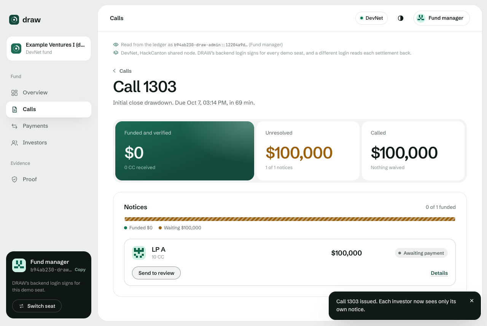
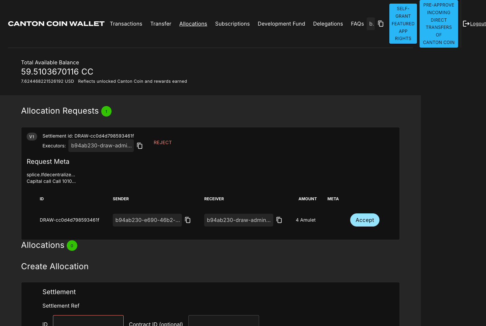
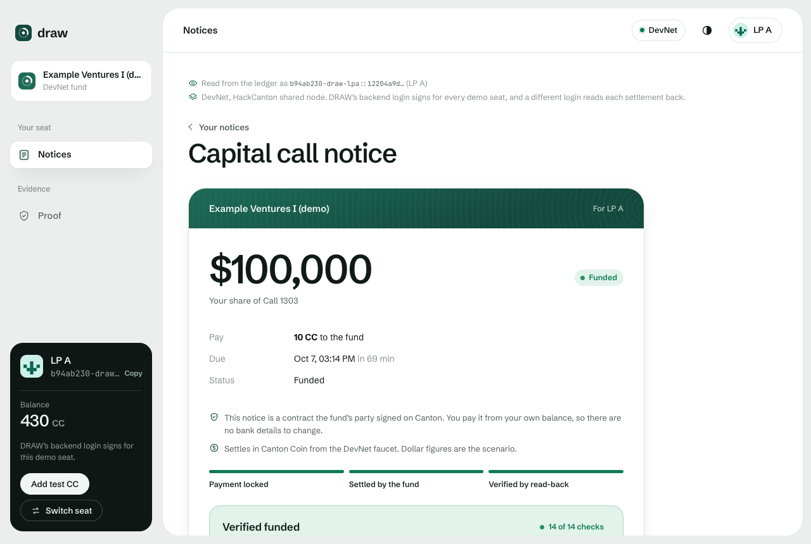

# Product

DRAW runs one capital call for a private fund, from the call to the money the fund can use. A capital call is how a fund collects money its investors already promised: each investor, an LP, commits an amount up front, and the fund draws it in parts when it needs it by sending each LP a notice for its share with a due date. In DRAW the fund issues the call once, and each LP gets its own notice, a contract between the fund and that LP that no other LP or unrelated party can read, though the operator of the node that hosts them can. The LP pays it from its Canton wallet, the fund settles it, and the fund counts the money as deployable only after a read-back step confirms the settlement on the ledger.

We built DRAW for the fund COO or operations lead at an emerging manager, a newer and smaller fund manager, and for the outsourced administrator who runs calls for such managers. This document describes the product for them and for judges: who does what in a call, step by step, what each side sees and what changes. Fund and Canton words are defined in [the glossary](README.md#words-used-in-these-docs).

The problem behind it, in short: today a notice goes out by email, each LP pays by wire, and someone matches wires to LPs and calls before the fund can say what's funded. At least one fund administration vendor does that matching in batches from bank exports the client provides. That's our hypothesis from 12 public sources, set out in [PROBLEM_EVIDENCE.md](PROBLEM_EVIDENCE.md). No fund operator has confirmed it yet.

## The decision it owns

"How much of this capital call is deployable right now, and what amount remains unresolved?"

The fund's dashboard opens on that question. Our hypothesis is that it's the question the fund's operations lead has to answer after every call.

- Deployable now is money that is funded and confirmed by the read-back step. The app counts a notice as funded only when its read-back receipt says `VERIFIED_FUNDED`. A notice the ledger shows as funded that the read-back hasn't confirmed yet shows as "Settled, verification pending" and doesn't count.
- Unresolved is everything called that isn't verified funded and isn't waived, whether it's unpaid, overdue, mismatched or in review.

Three records carry the workflow: the capital call, one notice per LP, and for each notice either a settlement receipt or a decision by the fund to mark it overdue, review it or waive it.

## Who uses it and who pays

| Role | Who | What they get from DRAW | Status |
|---|---|---|---|
| Fund manager and fund operations | The fund COO or operations lead at an emerging manager. In the app this is the Fund manager seat, and on the ledger the party called admin | Issues a call in one action, settles matching payments, works late and mismatched notices, and sees Deployable now and Unresolved | We built DRAW for this person. That it's the right first user is a hypothesis from public sources |
| Outsourced fund administrator | A firm that runs calls for one or more emerging managers | The same seat, run on the manager's behalf | Likely first channel, a hypothesis: one relationship reaches several funds |
| LP | Each investor in the fund | A private notice, a payment that matches exactly or is refused with a reason, and a 14-check receipt once it's funded | Needs a Canton party and holdings in the settlement asset ([What the LP needs](#what-the-lp-needs)) |
| Payer | The manager, as a subscription per fund, or the administrator, per call | The manager: a deployable figure tied to verified settlement and an explicit unresolved list. The administrator: less matching work across its clients | Hypothesis. No pricing conversation has happened and no price is set |
| Operator | Whoever runs DRAW's app server and the fund's ledger access | Runs the server | In the demo the server holds the backend client for every demo seat, and since 2026-10-07 a client for the read-back that only reads as the fund. In production it should hold no LP credentials ([SECURITY.md](SECURITY.md)) |
| Integrator | Whoever connects the fund's admin system, the LP's wallet or custodian, and the settlement asset | | Not built. Pilot stage 3 ([PILOT_PLAN.md](PILOT_PLAN.md)) |
| Named verifier party, optional | A party the fund names when it creates the fund, such as an auditor | Reads the fund, every call and every notice, including the settled amount. LP privacy is unchanged, and the ledger refuses it when it tries to act | Package 0.3.0, Daml Script only. No app screen for it yet |
| Lender, custodian or other outside views | | | Not built, and kept out of the core workflow |

User and payer differ when an outsourced administrator runs the call for a manager: the administrator works in DRAW, and either the administrator or the manager might pay. Both payer options are hypotheses.

## A capital call, step by step

Each step says what the fund does, what the LP does and what the ledger does, and on which network it has been shown. The dollar figures in the demo are a scenario, and the coin that moves on DevNet is Canton Coin from the DevNet faucet, which has no monetary value.

### 1. Set up the fund and its LPs, once

- The fund invites each LP with its committed amount.
- The LP accepts once, with its own credential. On the live site the demo seats accept through DRAW's backend client, and an LP signed in with HackCanton accepts with its own login. Accepting makes the LP a co-signer of every later notice under that commitment, which gives the ledger the LP authority that settlement needs. The model lets the fund use that authority only inside the settle step, after every check passes, and only on a payment the LP itself created. The LP doesn't sign each call.
- From then on DRAW's contract refuses any call above the LP's remaining commitment, with the reason "call exceeds remaining commitment". That's tested in Daml Script and hasn't run on a ledger yet.

In the demo the commitments come from the demo setup. There's no onboarding, KYC or document flow.

### 2. The fund issues the call

- The fund manager fills in a call name, a note, a due time and each LP's amount, and issues the call in one action. DRAW doesn't compute pro-rata shares, and its contract checks only that each amount fits the LP's remaining commitment.
- The ledger creates a separate notice for each LP, a contract between the fund and that LP that no other LP or unrelated party can read. The fund sees every notice and the call's total. An LP sees neither the total nor any other LP's amount.
- Each LP finds one new notice under "Your notices". On the live site, LP B opening LP A's notice link gets "Not on your ledger", because the ledger query made as LP B returns nothing.

Shown on DevNet on the live site, where one action issues the call, and on LocalNet, where one ledger transaction issued the call to all three LPs. On DevNet one backend client reads for every demo seat, so the app picks which party it reads as. Each LP reading with its own separate login, and getting nothing of another LP's notice even by contract id, was shown on LocalNet.

The call just issued, with everything still unresolved. From the live-site browser run on 2026-10-07, a $100,000 call to LP A paid as 10 CC, with DRAW's backend login signing for every demo seat and a different login reading each settlement back (the network note shows in each screen).

### 3. The LP's wallet gets a payment request

- With each notice the ledger also creates a payment request for that LP in the Token Standard's own form, a CIP-0056 AllocationRequest. That's the interface an app uses to ask a user for an allocation, and it names the settlement, payer, receiver, amount and instrument. Other LPs and unrelated parties can't see it.
- On the HackCanton node, the node's own Canton Coin wallet lists the request under Allocations, with Accept and Reject. It's the only wallet that has been shown listing and approving a DRAW request.

Shown on DevNet and in Daml Script. In the newest scripted DevNet run, LP A created its payment from its request and signed it with its own key, and in the scripted runs on the demo seats the run script did that through their shared credential. LP B paid with a plain allocation carrying the reference, which settles the same way. The wallet listing and Accept were shown with the team's own HackCanton login as the LP.

The node's Canton Coin wallet listing a DRAW capital call as an allocation request with Accept, cropped from [the wallet run's screenshot](../evidence/devnet/browser/web-hackcanton-wallet-20261006132730/04-wallet-request.png). The team's own login was the LP, and the server was on the backend client.

### 4. The LP pays

- The LP locks the exact amount in a Token Standard allocation that carries the notice's reference. Nothing has moved yet, and it doesn't count.
- There are three ways to do this today. On the live site, the backend client acts for the demo LP seat when you click Pay. An LP signed in with its own HackCanton login can pay from DRAW, which calls its own wallet's allocate API, or press Accept on the request under Allocations in the node's Canton Coin wallet.
- When the payment matches the notice, the fund sees "Payment received, ready to settle". When it doesn't, both sides see that it doesn't match, and the fund gets no Settle button for it.
- Only the exact amount settles. There are no partial payments, so any other amount is refused, and the LP withdraws it and pays again.

Shown on DevNet: paying from the demo seats on the live site, and both signed-in ways with the team's personal login as the LP. Paying from DRAW also ran signed in as xidoncapitals-t1, a second login NODERS created for the team, whose party isn't the team's personal party. The team ran both logins, and no outside LP has used DRAW. In a scripted DevNet run LP A and LP B each signed its own payment with its own key, with every party's key on the machine that ran the script. The mismatch screens ran in a browser only on LocalNet, in the 2026-10-04 runs on the earlier Vite app. On DevNet the ledger's refusal of a wrong amount comes from the scripted runs.

### 5. The fund settles

- The fund clicks Settle.
- In one transaction the ledger checks the reference, the leg id, the executor, the payer, the receiver, the instrument and the exact amount, moves the coin to the fund, and marks the notice funded. The payment carries the notice's reference, and the notice turns funded in the same transaction that moves the money.
- Anything that doesn't match is refused with the ledger's reason, for example "allocation amount does not equal amount due" or "allocation sender is not the obligated LP".
- Settle is a click by default. Automatic settlement of exact matches (`DRAW_AUTO_SETTLE=true`) is written and hasn't run against a ledger.

Settlement is shown in Daml Script, on LocalNet with Amulet and on DevNet with Canton Coin. A wrong amount, wrong payer, wrong reference and a replayed payment were refused on DevNet and LocalNet. A wrong executor, wrong call and wrong instrument were refused in Daml Script only.

### 6. A read-back step confirms it

- A read-back step reads the settlement and the fund's holdings from the ledger and runs 14 checks. Among them: the transaction ran the settle step, it executed and consumed the referenced payment, the fund's received holdings are active and in the right instrument, they equal the amount due, and the payer is the LP that owed it. [PROOF.md](PROOF.md#reading-a-receipt) lists all 14.
- Why a second step: the app's own record that it submitted a settlement isn't proof that money arrived. The read-back reads the settled transaction and the fund's coin holdings from the ledger itself, and a claim the ledger doesn't back, such as one notice's settlement offered as evidence for another, is marked CONTRADICTED and never counts.
- Only a receipt that passes all 14 counts as verified funded. Then the dashboard adds the money to Deployable now, and the LP's notice says "Verified funded" with 14 of 14 checks.
- Who reads back depends on the setup. On LocalNet it's a separate ledger login with read rights on the fund only, checked in each run to be unable to submit. On DevNet it's a client of its own, which the node reports can only read as the fund, and which the ledger refused when a scripted run tried to act as the fund with it. The live site has read back with that client since about 13:00 UTC on 2026-10-07, and used the demo seats' backend client before that. In the scripted run where each party signs with its own key, the team's own login, which submitted for every party, also read back, because that client may read only as the live site's fund party, and that run's fund was a different, external party. In every setup the read-back runs in the same process as the step that submitted the settlement.
- A fund can also name a verifier party that reads the fund, every call and every notice, and is refused when it tries to act. That's in package 0.3.0 and has run in Daml Script only. No ledger run has read back through it yet.

In the newest scripted DevNet run, 20261007T130259Z, the read-back receipts are stamped 5.0 s (LP A) and 5.3 s (LP B) after the settlements' record times, and in run 20261007T125638Z, with the read-back on its own client, 7.5 s and 5.2 s, each the read-back's clock against the ledger's. On LocalNet, with a scripted fund acting at once on one machine, payment locked to verified funded took 1,047 ms for LP A. None of these figures is production latency.

LP A's notice, verified funded with 14 of 14 checks. From the live-site browser run on 2026-10-07, a $100,000 call to LP A paid as 10 CC, with DRAW's backend login signing for every demo seat and a different login reading each settlement back (the network note shows in each screen).

### 7. Unpaid, late and wrong-party payments

- A notice nobody pays stays unresolved. The ledger refuses to mark it overdue before the due time. After it, the fund can mark it overdue with a click. There's no scheduler, and marking overdue takes no note. Shown in Daml Script, on LocalNet and on DevNet.
- A late payment still settles. Settle accepts an overdue or reviewed notice and records that it was paid after the due time, which is checked in Daml Script. In the LocalNet campaign, 26 late payments ended funded.
- The ledger refuses to settle a payment from the wrong party, and DRAW flags it for the fund, which sends the notice to review with a note. In the LocalNet campaign, 9 wrong-payer notices ended in review.

### 8. Review and waive

- The fund can send any open notice to review with a note: one that's issued, waiting on a payment, or overdue.
- It can reopen a reviewed notice with a note, put a notice back to awaiting payment with a note when the payment it was waiting on was withdrawn or expired, and waive an overdue or reviewed notice with a note.
- A waived notice leaves the unresolved total, and the LP sees that the fund waived it.

These are the fund's decisions by design, and each one is recorded on the ledger with its note. Tested in Daml Script, and the LocalNet campaign includes waived notices.

On the live site each browser gets its own demo fund. The demo funds share the same five parties, so keeping one browser out of another's fund is the app's doing, and keeping each LP out of the others' records is the ledger's.

## What each side sees

| Ledger state | The fund sees | The LP sees |
|---|---|---|
| Issued, no payment | Awaiting payment | Due |
| Issued, matching payment locked | Payment received, ready to settle | Payment locked, waiting for the fund |
| Issued, payment that doesn't match | Payment does not match | Your payment does not match the amount due |
| PaymentPending | Settling | Payment locked, the fund is settling it |
| Funded with a read-back receipt | Funded | Funded, with receipt |
| Funded without a receipt yet | Settled, verification pending | Settled, verification pending |
| Overdue | Overdue | Overdue |
| ManualReview | In manual review | Under review by the fund |
| Waived | Waived | Waived by the fund |

The fund also sees the totals for each call, Deployable now and Unresolved, and a list of what needs its attention. An LP sees only its own notices, its own payments and its own balance. An unrelated party sees nothing of the fund.

## What changes for each side

| Today | In DRAW, for fund operations | For the LP |
|---|---|---|
| A notice per LP, built in a spreadsheet or admin system | Kept, as an on-ledger notice, issued to every LP in one action | Its own notice, in DRAW |
| Notices sent by email | Removed. The LP reads its notice in DRAW. There are no notifications yet, so the LP sees it when it opens the app | Reads the notice in DRAW, where there are no emailed wire details to swap |
| The LP wires money with a reference typed by hand | Replaced by an allocation that carries the reference in a field the ledger checks | Locks the exact amount from its own Canton wallet |
| Operations matches wires to amounts, in at least one administrator's case in batches from bank exports | For payments made through DRAW, the ledger check in the settle step replaces off-ledger matching. A payment that doesn't match is refused with the ledger's reason | Sees straight away if its payment doesn't match, withdraws it and pays the exact amount |
| Operations updates the spreadsheet | Removed. The notice turns funded in the same transaction that moves the money | Sees "Verified funded" with a 14-check receipt |
| Operations chases unpaid LPs | Kept, and made explicit: overdue, in review and waived notices each show on the unresolved list | Sees if its notice is overdue, under review or waived |
| A report of funded versus outstanding | Recomputed from verified notices, as Deployable now and Unresolved | |

This table compares steps, from public process descriptions ([BASELINE_AND_COUNTERFACTUAL.md](BASELINE_AND_COUNTERFACTUAL.md)). No practitioner has walked through it with us yet.

What stays manual:

- The fund clicks Settle for each payment. Automatic settlement of exact matches is written and hasn't run against a ledger.
- The fund marks a notice overdue after the due time. There's no scheduler.
- Review, reopen, release and waive are the fund's decisions, each with a note.
- Wires paid outside DRAW still need matching, and their notices stay unresolved or go to review ([LPs who pay by wire](#lps-who-pay-by-wire)).
- An LP withdraws its own refused payment.

What this is worth to a fund, in fewer reconciliation questions, less matching work and fewer surprises in reported funded capital, is our hypothesis. Reconciliation hours, error rates and cost in a real fund haven't been measured.

## What the LP needs

- A Canton party, hosted by the LP itself or by a provider it trusts.
- Holdings in the settlement asset. Today that's Canton Coin from the DevNet faucet on DevNet, and Amulet on LocalNet. A real pilot needs an asset the fund and LPs already accept, such as a tokenized dollar.
- To accept its commitment on the ledger, once. In plain words, accepting gives the fund the LP's signature that settlement needs, so the LP signs its commitment once and after that only its own payments. The fund can use that signature only inside the settle step, after every check passes, and only on a payment the LP itself created. DRAW's contract still refuses any call above the LP's remaining commitment, which is tested in Daml Script.
- A wallet or participant whose validator has vetted DRAW's package, because every participant that confirms a DRAW transaction must have vetted it. Today that means the node's own Canton Coin wallet, for a party on the fund's node (DevNet, shown with the team's own login), a key of its own for a party the node operator allocates on the fund's node (DevNet, shown in a scripted run with every party's key on one machine), or on LocalNet a key in the LP's browser, with its party on LocalNet's LP participant, which hosts every LP there.

## LPs who pay by wire

Nothing in DRAW can mark a wire-paid notice funded, because the settle step is the only path to Funded and it needs a Token Standard payment. A notice paid by wire stays unresolved, or the fund sends it to review with a note, which is what stage 1 of the [pilot plan](PILOT_PLAN.md) does. It never counts as deployable.

A fund whose LPs all pay by wire still gets private notices and the explicit unresolved list. Funding that follows the money needs LPs who pay on Canton. Turning tokenized dollars into a bank wire the fund can invest isn't covered.

## How an LP knows a notice is real

Fake notices are a known fraud. Luxembourg's Financial Intelligence Unit has reported scams "using fake capital call or drawdown notices" (source 8 in [PROBLEM_EVIDENCE.md](PROBLEM_EVIDENCE.md)), and funds fight payment-instruction fraud with procedures such as dual approval and daily reconciliation (source 7).

A DRAW notice is a contract signed by the fund's party, and only a payment to that party can fund it. The LP reads its notice in DRAW, so there are no emailed wire details on it for anyone to swap. Three limits apply:

- It depends on the LP knowing the fund's real party, and DRAW doesn't build that onboarding.
- DRAW can't stop fake payment instructions emailed outside DRAW.
- No run has tested a fake-notice attack.

## What a notice carries

- A call name and a note from the fund.
- The due date and time.
- The LP's amount, in scenario dollars and in token units, labeled separately. A fund uses one currency and instrument.
- A random reference, `DRAW-` followed by 16 hex characters, such as `DRAW-326d625363383952`. The token registry can see the reference, so it names no LP, fund or call ([DECISIONS.md](DECISIONS.md), D-009).

It doesn't carry the line items of ILPA's capital call and distribution template.

## What DRAW is not

DRAW runs one capital-call workflow end to end: issue, a private notice per LP, payment, settlement, read-back, and an explicit unresolved list. It isn't fund accounting, NAV, KYC, a secondary market, a lending product, an audit console or a generic dashboard. Anyone shopping for accounting, NAV, KYC or investor reporting isn't a fit.

## Read next

- [BUSINESS_BRIEF.md](BUSINESS_BRIEF.md): the business case, customer, payer and first channel.
- [LIMITATIONS.md](LIMITATIONS.md): what isn't done or shown, by network.
- [ARCHITECTURE.md](ARCHITECTURE.md): parties, contracts, who sees what, and the settlement lifecycle in code.
- [PROOF.md](PROOF.md): where each claim above is checked and how to rerun it.
